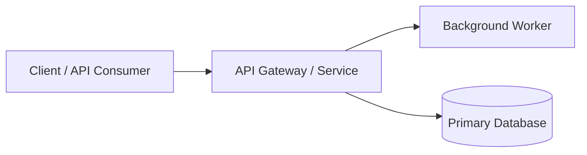

# System Architecture

> High-level summary of the architecture pattern (e.g., modular monolith, event-driven microservices) and primary design goals.

## System Diagram

## Core Components
* **<Component / Service Name> (`path/to/entry`):** Responsibility, protocol/port, and key dependencies.
* **<Data Store / Queue>:** What data it holds, retention/caching strategy, and schema location.

## Data Flow & Lifecycles
1. **Ingestion / Request:** How requests or events enter the system and get validated.
2. **Processing:** Core business logic, transformations, or async jobs triggered.
3. **Persistence & Output:** How state is saved and responses/webhooks are returned.

## Key Design Decisions & Trade-offs
* **<Decision Title>:** Brief rationale for why this approach or technology was chosen over alternatives.

## Security & Scalability Notes
* Authentication/authorization boundaries, secrets handling, and horizontal scaling bottlenecks.
