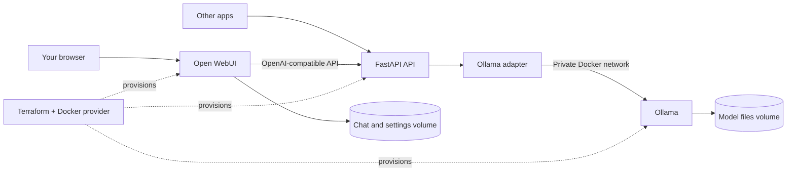

# Local AI Platform Foundation

Chat with a language model on your computer, or connect another app through the API.

## Overview

This project runs Open WebUI, a FastAPI service, and Ollama in Docker. Open WebUI is the chat page, and the API lets other apps use the same local model.

## How It Works

1. Terraform creates the Docker services, networks, and data volumes.
2. You open Open WebUI in your browser or send a request to the API.
3. The API sends model requests to Ollama over a private Docker network.
4. Ollama returns the model's answer through the API.

## Architecture

Open WebUI and other clients send requests to the FastAPI service. The service talks to Ollama through an adapter, so clients do not depend on Ollama directly.



See the [full architecture guide](docs/architecture.md).

## Tech Stack

| Part | Version or image |
| :--- | :--- |
| Terraform | `1.17.0` |
| Docker provider | `kreuzwerker/docker` `4.6.0` |
| Docker runtime | Docker Desktop / Docker Engine |
| API runtime | Python `3.14.8` (`python:3.14.8-slim-trixie`) |
| FastAPI | `0.162.0` |
| HTTPX | `0.28.1` |
| Pydantic / pydantic-settings | `2.14.1` / `2.16.1` |
| Uvicorn | `0.54.0` |
| Platform API image | `local-ai-platform-api:1.2.0` (built locally) |
| Open WebUI image | `openwebui/open-webui:0.13.4` |
| Ollama image | `ollama/ollama:0.40.16` |
| Default model | `llama3.1:8b` |
| Persistent storage | Docker volumes `local-ai-platform-ollama-models` and `local-ai-platform-open-webui-data` |
| Tests and linting | pytest `9.2.0`, Ruff `0.17.3` |

## Getting Started

Install and start Docker Desktop and Terraform `1.17.0`. From the project folder, prepare Terraform and inspect the plan:

```powershell
terraform -chdir=infra/terraform init
terraform -chdir=infra/terraform plan
```

Review the plan, then start the services:

```powershell
terraform -chdir=infra/terraform apply
```

Download the default model once:

```powershell
docker exec ollama ollama pull llama3.1:8b
```

Open the chat page at <http://127.0.0.1:3000>. The API is at <http://127.0.0.1:8000>. Both are for local use and do not have sign-in protection.

For setup details, configuration, API examples, stopping services, and troubleshooting, see the [Getting Started guide](docs/getting-started.md).
