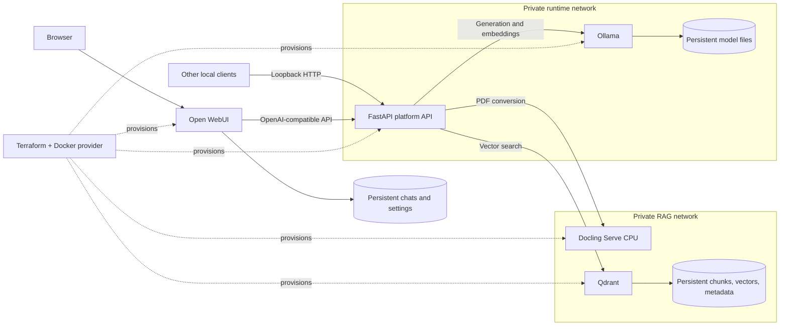

# Local AI Platform Foundation

Chat with local language models and ground selected conversations in your own PDF documents.

## Overview

This project provisions a local AI platform with Terraform and Docker. Open
WebUI is the chat client, FastAPI is the client-facing API, and Ollama runs the
selected generation model. The release scope now includes PDF retrieval-
augmented generation (RAG) through a separate Docling Serve CPU container and
Qdrant vector store.

The RAG path uses the selected Ollama chat model. It does not alter or duplicate
that model. Ollama also runs the fixed `nomic-embed-text:v1.5` model to embed
PDF chunks and user questions. The RAG implementation is planned; the current
API and Terraform implementation must be completed before the RAG workflow is
available.

## How It Works

1. Terraform provisions Docker networks, containers, and persistent volumes.
2. Open WebUI lists direct and RAG choices for each supported Ollama chat
   model. Direct chat calls the selected model; the RAG choice retrieves
   document passages first, then calls that same model.
3. To index a PDF up to 1 GB (1,000,000,000 bytes), a client uploads it to
   FastAPI. FastAPI sends it to Docling Serve for extraction, chunks the
   extracted text, embeds each chunk through Ollama, and stores the vectors,
   text, and source metadata in Qdrant.
4. For RAG chat, FastAPI embeds the latest user question with the same
   embedding model, searches Qdrant, and sends relevant source-labelled
   passages to the selected Ollama model.
5. The API returns or streams the answer with citations. If no relevant
   passages are found, the RAG choice reports that the documents do not provide
   enough information.

Uploaded PDFs are processed temporarily and are not retained by the platform.
Users keep source files outside the platform for re-indexing. Qdrant retains
the extracted index across routine teardown. The initial release does not
create Qdrant snapshots: if the index is lost or deleted, recreate it by
uploading the externally retained PDFs again. Volume persistence protects
against routine teardown, not volume loss.

PDF ingestion is synchronous with a configurable 120-second end-to-end deadline
that includes file transfer and indexing. Only one upload runs at a time; a
concurrent upload is rejected with HTTP 429. Temporary files and partial index
entries are cleaned up when processing ends. The 1 GB cap is a hard ceiling;
some smaller PDFs may time out, and the practical page limit must be measured
on the target host. A configurable total-chunk cap will limit Qdrant collection
growth; its value will be set from target-host storage measurements. This cap
does not limit other Docker disk usage.

## Architecture

FastAPI remains the boundary between clients and all model and retrieval
services. Open WebUI reaches FastAPI over the client Docker network. FastAPI
reaches Ollama over the private runtime network and Docling Serve and Qdrant
over the private RAG network. Only FastAPI can reach those internal services;
their ports are not published to the host.



See the [full architecture guide](docs/architecture.md) and [Architecture
Decision 0001](docs/decisions/0001-local-rag-architecture.md).

## Tech Stack

| Part | Version or image |
| :--- | :--- |
| Terraform | `1.17.0` |
| Docker provider | `kreuzwerker/docker` `4.6.0` |
| Docker runtime | Docker Desktop / Docker Engine |
| API runtime | Python `3.14.8` (`python:3.14.8-slim-trixie`) |
| FastAPI | `0.162.0` |
| HTTPX | `0.28.1` |
| Pydantic / pydantic-settings | `2.14.1` / `2.16.1` |
| Uvicorn | `0.54.0` |
| Platform API image | `local-ai-platform-api:1.2.0` (built locally) |
| Open WebUI image | `openwebui/open-webui:0.13.4` |
| Ollama image | `ollama/ollama:0.40.16` |
| Default generation model | `llama3.1:8b` |
| Embedding model | Ollama `nomic-embed-text:v1.5`, default 768-dimensional output |
| Vector schema | Qdrant Cosine distance; compare Nomic task prefixes during evaluation |
| PDF conversion | `ghcr.io/docling-project/docling-serve-cpu:v1.38.2`; record digest before deployment |
| Vector store | `qdrant/qdrant:v1.20.2`; record digest before deployment |
| Persistent storage | Ollama model, Open WebUI data, and Qdrant data Docker volumes |
| Tests and linting | pytest `9.2.0`, Ruff `0.17.3` |

The primary validation host is Windows with Docker Desktop, WSL2, and Linux
containers. Its target profile is an 8-core modern x86-64 CPU (AVX2 preferred),
32 GiB RAM with about 24 GiB available to Docker, and SSD storage with at least
50 GB free before image and model downloads. The 10 GB post-setup free-space
figure is provisional, not a verified ongoing reserve. Benchmark temporary
processing and index growth before setting an ongoing free-space target.
Validate CPU-only first; an NVIDIA GPU is optional for Ollama and is a
separate validation profile.
Docling Serve uses its CPU image. The target remains unverified until the
document-conversion and inference workload passes on it. Validate with the
default `llama3.1:8b` model while a representative PDF is ingested and a chat
request runs concurrently; record peak resources and chat latency.

## Getting Started

Install and start Docker Desktop and Terraform `1.17.0`. From the project
folder, prepare Terraform and inspect the plan:

```powershell
terraform -chdir=infra/terraform init
terraform -chdir=infra/terraform plan
```

Review the plan, then start the services:

```powershell
terraform -chdir=infra/terraform apply
```

Download the generation and embedding models once:

```powershell
docker exec ollama ollama pull llama3.1:8b
docker exec ollama ollama pull nomic-embed-text:v1.5
```

Open the chat page at <http://127.0.0.1:3000>. The API is at
<http://127.0.0.1:8000>. Both are for local use and do not have sign-in
protection. RAG upload and chat operations become available when the planned
RAG implementation is complete.

For setup details, configuration, API examples, data retention, stopping
services, and troubleshooting, see the [Getting Started guide](docs/getting-started.md).
