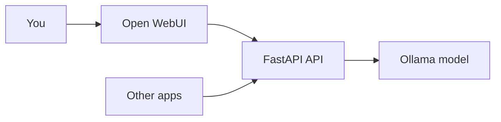

# Local AI Platform

A small AI chat service that runs on your computer. Open WebUI gives you a chat page. FastAPI provides the API. Ollama runs the language model.

## How it works



The chat page and other apps both use the API. Ollama stays behind the API.

## Start the platform

You need Docker Desktop and Terraform 1.17.0. Start Docker Desktop first.

From the project folder, prepare Terraform and review what it plans to change:

```powershell
terraform -chdir=infra/terraform init
terraform -chdir=infra/terraform fmt -check
terraform -chdir=infra/terraform validate
terraform -chdir=infra/terraform plan
```

Review the plan and check that it keeps your saved data. Then start the services:

```powershell
terraform -chdir=infra/terraform apply
```

Download the default model once:

```powershell
docker exec ollama ollama pull llama3.1:8b
```

Open the chat page at <http://127.0.0.1:3000>.

## Use the API

The API is at <http://127.0.0.1:8000>. Other apps on your computer can use it too.

- `GET /v1/models` lists the models.
- `POST /v1/chat/completions` sends a chat request. It supports regular and streaming replies.
- `GET /api/v1/models` and `POST /api/v1/chat` are the platform's own API routes.
- <http://127.0.0.1:8000/docs> lets you try the platform API in a browser.

Try the model list from PowerShell:

```powershell
curl.exe http://127.0.0.1:8000/v1/models
```

The OpenAI-compatible API does not require a real API key. The UI sends a placeholder key that the API ignores.

## Stop and start the services

Stop the project containers. This keeps their settings and saved data:

```powershell
docker stop local-ai-platform-open-webui local-ai-platform-api ollama
```

Start them again in this order:

```powershell
docker start ollama
docker start local-ai-platform-api
docker start local-ai-platform-open-webui
```

## Where your data lives

- Ollama models are in the Docker volume `local-ai-platform-ollama-models`.
- Open WebUI chats and settings are in `local-ai-platform-open-webui-data`.
- FastAPI does not save chat history.

Docker keeps both volumes when you stop the services or run `terraform destroy`. On Windows, Docker Desktop stores the files inside its Linux environment, not in this project folder. See the [Terraform guide](infra/terraform/README.md) before permanently deleting a volume.

The UI and API are set up for use on this computer. They do not have sign-in protection. Keep them on localhost.

## Check or fix a service

See which containers are running:

```powershell
docker ps --filter "name=local-ai-platform-api" --filter "name=ollama" --filter "name=local-ai-platform-open-webui" --format "table {{.Names}}\t{{.Status}}\t{{.Ports}}\t{{.Size}}"
```

View a service's recent messages:

```powershell
docker logs --tail 100 local-ai-platform-api
docker logs --tail 100 ollama
docker logs --tail 100 local-ai-platform-open-webui
```

## Run the checks

Python 3.14 is needed for these checks:

```powershell
python -m venv .venv
.\.venv\Scripts\Activate.ps1
python -m pip install -e ".[dev]"
python -m pytest tests/unit
python -m ruff check .
python -m ruff format --check .
```

## More details

- [Terraform setup and data cleanup](infra/terraform/README.md)
- [API details](platform/README.md)
- [Architecture](docs/architecture.md)
- [Project scope](docs/project-scope.md)
