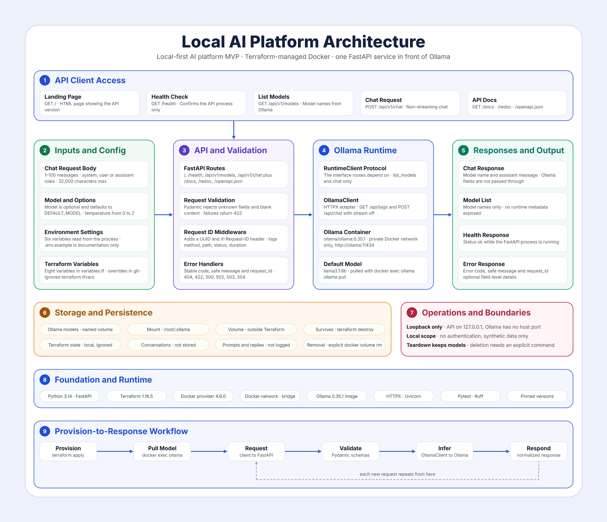

# AI Platform Foundation — Local

A local-first AI platform MVP built with Terraform, Docker, FastAPI, and Ollama.
The project demonstrates repeatable infrastructure provisioning and a stable
API boundary around locally hosted language models.

## Architecture



The static diagram shows the architecture of this application, which includes the API runtime, validation and settings, and Ollama runtime.

Detailed architecture is here: [architecture.md](docs/architecture.md)

## Tech Stack

| Area | Frameworks |
| --- | --- |
| Infrastructure | Terraform (1.16.5); Docker provider (4.6.0) |
| Container runtime | Docker Engine (host-installed; version not pinned) |
| Platform API | Python (3.14); FastAPI (0.142.2); Pydantic (2.13.5); Uvicorn (0.54.0) |
| Model runtime | Ollama (0.35.1) `ollama/ollama:0.35.1` container image |
| Default model | [`llama3.1:8b`](https://ollama.com/library/llama3.1) |
| Quality | HTTPX (0.28.1); Pytest (9.1.1); Ruff (0.16.10) |

The API exposes health, model-listing, and non-streaming chat endpoints. It
validates requests and normalizes responses; Ollama-specific HTTP details stay
inside the runtime adapter. See [`docs/project-scope.md`](docs/project-scope.md)
for the complete MVP scope and acceptance criteria.

## Project Status

The FastAPI application, Ollama adapter, Terraform Docker resources, and unit
tests are implemented. Terraform builds and runs the API and Ollama containers,
publishes the API on loopback, and retains Ollama model data across routine
teardown. Review the Terraform plan before applying it.

The initial CPU-only validation target is an x86-64 host with 8 GiB of RAM and
at least 10 GiB of free disk. This is a target profile, not a verified minimum.

The API is intended to run as part of the Terraform-managed Docker environment;
it uses `http://ollama:11434` to reach Ollama on the private Docker network.
This project does not support connecting the API to a host-local Ollama server.
After deployment, the API provides `GET /`, `GET /health`,
`GET /api/v1/models`, and `POST /api/v1/chat` on `127.0.0.1:8000`. 

Interactive Swagger UI is available at `http://127.0.0.1:8000/docs`; use **Try it out** to
submit requests from the browser. The OpenAPI schema is at
`http://127.0.0.1:8000/openapi.json`, and ReDoc is available at
`http://127.0.0.1:8000/redoc`.

## Local Environment Setup

The API and Ollama run as Docker containers; a host Ollama installation is not
required or supported. The commands in this README use Windows PowerShell.

Required host tools:

- Docker Desktop configured for Linux containers, with the Docker Engine
  running. See the [official Windows installation guide](https://docs.docker.com/desktop/setup/install/windows-install/).
- Terraform CLI 1.16.5 on `PATH`. Follow the
  [official HashiCorp install instructions](https://developer.hashicorp.com/terraform/install)
  and select version 1.16.5.
- Python 3.14 and pip for unit tests and linting only. Use the
  [official Python for Windows downloads](https://www.python.org/downloads/windows/).
- Git, if you need to clone the repository.

Open a new PowerShell window after installation, then verify the tools:

```powershell
docker version
terraform version
python --version
```

The Terraform provider is installed by `terraform init`. The API's FastAPI and
runtime dependencies are installed in its Docker image; they do not need a
separate host installation. To install the pinned local test and lint tools,
create a Python virtual environment from the repository root:

```powershell
python -m venv .venv
.\.venv\Scripts\Activate.ps1
python -m pip install -e ".[dev]"
```

## Tests and API Image

Use Python 3.14 to run unit tests and Ruff checks from the repository root:

```powershell
python -m pytest tests/unit
python -m ruff check .
python -m ruff format --check .
```

Build the API container image from the repository root:

```powershell
docker build -f platform/Dockerfile -t local-ai-platform-api:1.1.0 .
```

## Deploy the Docker Platform

With Terraform 1.16.5, Docker provider 4.6.0, and Docker Engine available, run
these commands from the repository root. Review the plan before applying it:

```powershell
terraform -chdir=infra/terraform init
terraform -chdir=infra/terraform fmt -check
terraform -chdir=infra/terraform validate
terraform -chdir=infra/terraform plan
terraform -chdir=infra/terraform apply
```

Terraform builds the API image and publishes it on `127.0.0.1:8000`. Ollama is
available only on the internal Docker network. After apply, prepare the
model you want the API to use. The repository default is `llama3.1:8b`; if you
use another model, set Terraform's `default_model` to that tag and apply the
reviewed change, or include the tag in each chat request. For example, to use
Qwen:

```powershell
docker exec ollama ollama pull qwen2.5:1.5b
```

Verify the API health and model-listing endpoints after the model is ready:

```powershell
curl.exe http://127.0.0.1:8000/health
curl.exe http://127.0.0.1:8000/api/v1/models
```

## Verify and Debug Deployment

A successful `terraform apply` ends with `Apply complete!` and prints the
`api_url` output. Check Terraform's outputs and managed resources, then confirm
that both containers are running:

```powershell
terraform -chdir=infra/terraform output
terraform -chdir=infra/terraform state list
docker ps --filter "name=local-ai-platform-api" --filter "name=ollama" --format "table {{.Names}}\t{{.Status}}\t{{.Ports}}"
```

The state should include the API and Ollama containers and the platform
network. `docker ps` should show `local-ai-platform-api` and `ollama` as
running; only the API should publish port `8000`, bound to `127.0.0.1`.
Terraform output `api_url` should be `http://127.0.0.1:8000` unless
`api_host_port` was overridden.

If a container is missing, stopped, or unhealthy, inspect its status and recent
logs:

```powershell
docker inspect --format "{{.Name}}: {{.State.Status}}{{if .State.Health}} (health: {{.State.Health.Status}}){{end}}" local-ai-platform-api ollama
docker logs --tail 100 local-ai-platform-api
docker logs --tail 100 ollama
```

Check the API container's configured default, the models installed in Ollama,
and the models visible through the API:

```powershell
docker inspect --format "{{range .Config.Env}}{{println .}}{{end}}" local-ai-platform-api | Select-String "^DEFAULT_MODEL="
docker exec ollama ollama list
curl.exe http://127.0.0.1:8000/health
curl.exe http://127.0.0.1:8000/api/v1/models
```

`/health` checks API liveness only. If `/api/v1/models` returns an empty list,
Ollama has no model installed. Pull the tag shown by `DEFAULT_MODEL` (the
repository default is `llama3.1:8b`; replace it below if you overrode that
value) and check the list again. If `ollama list` shows a model but the API list
is empty, inspect the container logs above. A chat request's `model` must match
a name returned by `/api/v1/models`:

```powershell
docker exec ollama ollama pull llama3.1:8b
curl.exe http://127.0.0.1:8000/api/v1/models
```

If Terraform did not finish successfully or expected resources are missing,
review the current plan before applying again:

```powershell
terraform -chdir=infra/terraform plan
```

Swagger UI is available at `http://127.0.0.1:8000/docs`.

Routine `terraform destroy` removes Terraform-managed images and preserves the
Ollama model volume. Cleanup details and explicit volume deletion steps are in
[`infra/terraform/README.md`](infra/terraform/README.md).

## Security and Data

- Keep the unauthenticated API bound to localhost; do not publish Ollama's API
  to the host by default.
- Use synthetic or non-sensitive data only. This project is not HIPAA-compliant
  and is not intended for regulated workloads.
- Do not log prompts or responses by default.
- Never commit credentials, private keys, `.env` files, Terraform state, or
  real environment-specific `.tfvars` files.
- Treat model files as persistent data; review Terraform plans and document
  cleanup before deleting them.

## Future Scope

Cloud deployment, Kubernetes, authentication, a frontend, RAG, vector databases,
document ingestion, agent workflows, and model training are intentionally
excluded from the MVP. See [`docs/architecture.md`](docs/architecture.md) for
the selected architecture and remaining implementation decisions.
