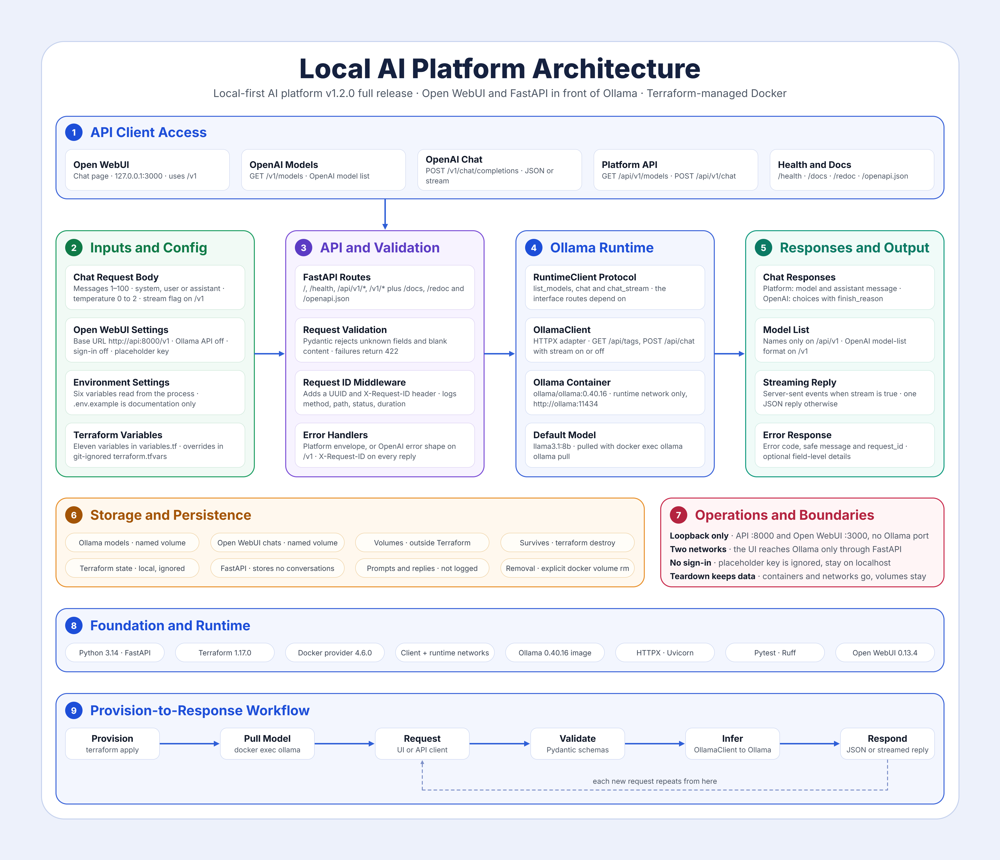
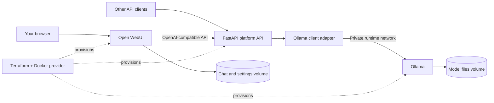

# System Architecture

The Local AI Platform Foundation runs Open WebUI, a FastAPI service, and Ollama on one computer with Docker. The API is the boundary between clients and the model runtime, so Open WebUI and other apps do not need to speak to Ollama directly.

## System Diagram

The diagram shows the full platform. This editable flow shows the main request path:

## Core Components

| Component | Job |
| :--- | :--- |
| Terraform with the Docker provider | Creates the containers, Docker networks, and persistent data volumes. |
| Open WebUI | Provides the browser chat page and stores chats and settings. |
| FastAPI platform API | Validates client requests, exposes platform and OpenAI-compatible routes, and returns model responses. |
| Ollama client adapter | Keeps Ollama-specific HTTP requests and responses inside the API. |
| Ollama | Downloads model files and runs the selected language model. |

The API container joins both Docker networks: the client network for Open WebUI and the private runtime network for Ollama. Open WebUI and Ollama each join only their own network.

## Data Flow & Lifecycles

1. A person uses Open WebUI, or another app sends a request to the API on `127.0.0.1:8000`.
2. Open WebUI uses the API's OpenAI-compatible `/v1` routes. Other apps can use those routes or the platform's `/api/v1` routes.
3. The API validates the request and passes model work to its Ollama adapter.
4. The adapter calls Ollama over the private Docker network. The API returns the answer to the client.
5. Ollama model files live in `local-ai-platform-ollama-models`. Open WebUI chats and settings live in `local-ai-platform-open-webui-data`. The API does not store chat history.

Terraform destroys the containers and networks during `terraform destroy`. The two named volumes are retained, so model files, chats, and settings survive. The Terraform guide explains how to remove those volumes permanently.

## Key Design Decisions & Trade-offs

- **Keep the API between clients and Ollama.** This gives other apps a stable API and keeps runtime-specific behavior in one adapter. It adds one service and one network hop.
- **Use OpenAI-compatible routes for Open WebUI.** This lets the chat page use the platform API. The API also keeps its own `/api/v1` routes.
- **Run everything on one Docker host.** Terraform makes the local setup repeatable, but this design does not provide high availability or multi-host scaling.
- **Keep model and chat data in named volumes.** Routine container teardown does not force large model downloads or erase saved chats. The operator must explicitly remove volumes to delete that data.

## Security & Scalability Notes

- The API and Open WebUI publish ports on `127.0.0.1` only. Ollama has no host port mapping.
- This local setup has no sign-in protection. Open WebUI sends a placeholder API key, which the platform API ignores. Do not expose the services to a network without adding appropriate access controls first.
- Use synthetic or non-sensitive data. This project is not designed or claimed to be compliant for regulated data.
- The current deployment is a single-host development platform. It has no authentication, high availability, or horizontal scaling.

For image versions, configuration, and operation steps, see the [Getting Started guide](getting-started.md) and [Terraform guide](../infra/terraform/README.md).
