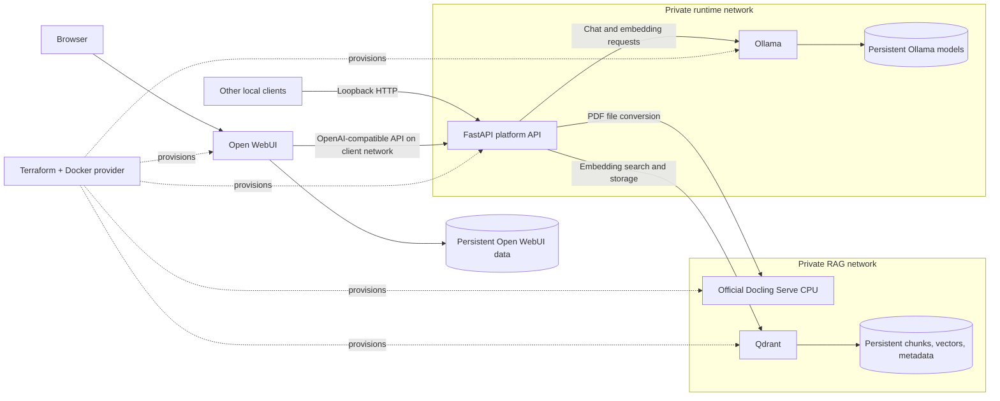

# System Architecture

The Local AI Platform Foundation runs Open WebUI, FastAPI, Ollama, Docling
Serve, and Qdrant on one Docker host. FastAPI remains the client-facing
boundary and orchestrates model generation, PDF conversion, embeddings, and
retrieval. Open WebUI and other clients never call Ollama, Docling Serve, or
Qdrant directly.

This document describes the target RAG architecture. The implementation and
deployment work is tracked separately.

## System Diagram

FastAPI joins the client, runtime, and RAG networks. Open WebUI joins only the
client network; Ollama joins only the runtime network; Docling Serve and Qdrant
join only the RAG network. Only FastAPI can reach the runtime and RAG services.
The Docling Serve and Qdrant ports are not published to the host.

## Core Components

| Component | Responsibility |
| :--- | :--- |
| Terraform with the Docker provider | Creates containers, private networks, loopback port mappings, and persistent data volumes. |
| Open WebUI | Provides the browser chat page and stores chats and settings. It shows direct and RAG choices for supported Ollama chat models. |
| FastAPI platform API | Validates client requests and coordinates direct chat, document ingestion, retrieval, and RAG chat. |
| Ollama client adapter | Isolates Ollama HTTP requests and responses, including chat generation and embeddings. |
| Ollama | Runs the selected generation model and the fixed `nomic-embed-text:v1.5` embedding model. |
| `ghcr.io/docling-project/docling-serve-cpu` | Converts uploaded PDFs to structured text and source metadata through its API. |
| `qdrant/qdrant` | Stores and searches embedded text chunks and source metadata. |

The official Docling Serve CPU container `ghcr.io/docling-project/docling-serve-cpu`
is separate from the platform API
image. Pin its release and immutable image digest before implementation. The
Qdrant image must also be pinned. The exact image references are deployment
decisions to record when implementation begins.

## Chat Model Choices

For each supported Ollama chat model, FastAPI exposes a direct entry and a RAG
entry through the OpenAI-compatible model list. For example,
`llama3.1:8b` routes directly to Ollama, while `llama3.1:8b-rag` is a FastAPI
alias that performs retrieval before calling the same `llama3.1:8b` model. The
RAG alias is not a separate Ollama model file. FastAPI resolves aliases
explicitly and never forwards an alias to Ollama.

`nomic-embed-text:v1.5` is a separate fixed embedding model. It embeds both
document chunks during ingestion and the latest user message during search.
The embedding model is not offered as a chat choice. Changing the embedding
model requires rebuilding the Qdrant collection from the source PDFs.

## Document Ingestion Flow

1. A local client uploads a PDF to FastAPI. FastAPI validates the file type,
   upload size, page limit, and request timeout.
2. FastAPI sends the file to Docling Serve's file-conversion API over the
   private RAG network. URL-based conversion is not used.
3. Docling Serve returns structured extracted text and metadata. FastAPI keeps
   page and source metadata for citations.
4. FastAPI chunks the extracted text deterministically and embeds each chunk
   through Ollama using `nomic-embed-text:v1.5`.
5. FastAPI stores each vector with its text, stable document ID, source name,
   and page/chunk metadata in Qdrant.

The initial release accepts PDF files. Scanned-PDF OCR is deferred until
resource use and page-citation quality are validated on the target host. Qdrant
retains extracted chunks, vectors, and source metadata. The proposed default
is to process original PDFs transiently and require operators to keep their
source files for re-indexing; confirm this retention policy before
implementation.

## RAG Chat Flow

1. Open WebUI sends the selected model ID and conversation messages to
   `POST /v1/chat/completions`.
2. FastAPI routes direct entries to Ollama without retrieval. For a RAG entry,
   it embeds the latest user message with `nomic-embed-text:v1.5` and searches
   Qdrant.
3. FastAPI selects relevant chunks, labels them with their document and page
   sources, and adds them as untrusted context to the conversation.
4. FastAPI sends the resulting request to the underlying Ollama model chosen
   by the RAG alias. It streams or returns the answer with source references.
5. If no relevant chunks meet the configured threshold, the RAG entry reports
   that the document set does not provide enough information. If Docling,
   Ollama embeddings, or Qdrant is unavailable, the RAG request fails visibly
   instead of silently falling back to direct chat.

Direct and RAG choices are independently selected per Open WebUI conversation.
The direct path remains available for general questions; the RAG path is
strictly grounded in retrieved document passages.

## API and Data Lifecycle

The API provides local operations for PDF upload, document listing and
deletion, retrieval search, and RAG chat. It also retains the existing
`/api/v1/chat` and OpenAI-compatible direct chat contracts. Document deletion
removes every matching point from Qdrant. RAG answers include readable
citations; the platform-native RAG response also returns structured source
metadata.

Ollama model files, Qdrant vectors and chunks, and Open WebUI conversations use
separate named Docker volumes. Routine `terraform destroy` removes service
containers and networks but preserves these volumes. Permanent data removal is
a separate explicit cleanup operation documented in the Terraform guide.
Docling Serve is a conversion service, not a document archive.

## Security and Resource Constraints

- FastAPI and Open WebUI publish ports on `127.0.0.1` only. Ollama, Docling
  Serve, and Qdrant have no host port mappings.
- Only FastAPI can reach Docling Serve and Qdrant. The parser is called with
  uploaded files only, preventing arbitrary URL fetches through its conversion
  API.
- Configure explicit upload size, page count, conversion timeout, and
  concurrency limits. Keep conversion concurrency low on CPU-only hosts.
- Treat retrieved passages as untrusted prompt context. Do not log source
  content, prompts, retrieved chunks, or model responses by default.
- Use synthetic or non-sensitive data only. The project is not designed or
  claimed to be compliant for regulated data.
- Docling's CPU image and bundled parsing models add substantial disk and
  memory use. Validate the 8 GiB RAM / 10 GiB free disk target while parsing
  and generating concurrently before calling it supported.

See [Architecture Decision 0001](decisions/0001-local-rag-architecture.md) for
the alternatives and rationale. For image versions, configuration, and
operation steps, see the [Getting Started guide](getting-started.md) and
[Terraform guide](../infra/terraform/README.md).
