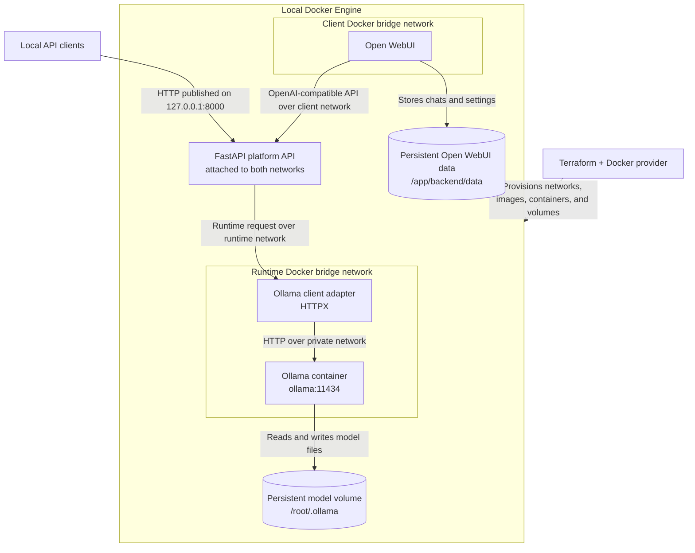

# Architecture

## Intent

Build a small, local-first AI platform that can be provisioned and operated
repeatably. The design should favor understandable components, explicit
configuration, and safe defaults over production-scale complexity.

## Selected MVP

- **Infrastructure:** Terraform with the Docker provider, in `infra/terraform/`.
- **Container runtime:** Docker Engine.
- **Chat client:** Open WebUI `v0.13.4`, published on loopback.
- **Platform API:** Python/FastAPI in `platform/`.
- **API compatibility:** OpenAI-compatible model listing and streaming or
  non-streaming chat completions, alongside the versioned platform routes.
- **Model runtime:** Ollama, reachable by the API over a private runtime network.
- **Host access:** publish the API on `127.0.0.1:8000` and Open WebUI on
  `127.0.0.1:3000`; do not publish Ollama's API to the host.
- **Automation and docs:** repeatable workflows belong in `scripts/`; project
  documentation belongs in `docs/` and the relevant directory README.

The MVP uses Open WebUI as its chat client and does not include custom frontend
development, authentication, cloud deployment, or orchestration beyond Docker.

## Infrastructure and Software Design

The diagram shows the local Docker boundary, the chat request path, and the
resources provisioned by Terraform. The model volume persists when Terraform
destroys the containers.

## Implementation Decisions

Terraform 1.17.0 and Docker provider 4.6.0 manage the local services. The API
image uses Python 3.14.8; Ollama uses `ollama/ollama:0.35.1`; Open WebUI uses
`ghcr.io/open-webui/open-webui:v0.13.4`. The API is attached to both the client
and runtime networks, while Open WebUI and Ollama each attach to only one. This
keeps model traffic routed through FastAPI. Both host ports bind to loopback.
Named Docker volumes retain model artifacts and Open WebUI conversations and
settings across routine teardown; permanent deletion is a separate operator
action documented in `infra/terraform/README.md`.

The API remains independently available to other clients on
`http://127.0.0.1:8000`. Open WebUI calls `http://api:8000/v1` inside Docker.
Its placeholder bearer token is ignored by the API, which has no authentication
in this local MVP.

Remaining validation includes recording measured resource use for the target
hardware profile and running end-to-end tests against the pinned model without
sending prompts or model data externally.

## Operational principles

- Pin tool, provider, image, and model versions before implementation is treated
  as reproducible.
- Keep generated state and credentials out of version control.
- Make setup, health checks, upgrades, and teardown explicit and repeatable.
- Document hardware assumptions, resource requirements, and known limitations.
