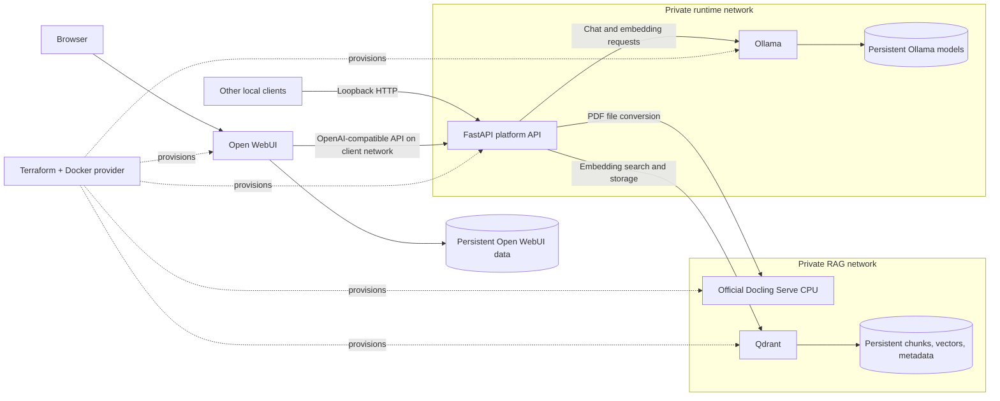

# System Architecture

The Local AI Platform Foundation runs Open WebUI, FastAPI, Ollama, Docling
Serve, and Qdrant on one Docker host. FastAPI remains the client-facing
boundary and orchestrates model generation, PDF conversion, embeddings, and
retrieval. Open WebUI and other clients never call Ollama, Docling Serve, or
Qdrant directly.

This document describes the target RAG architecture. The implementation and
deployment work is tracked separately.

## System Diagram

FastAPI joins the client, runtime, and RAG networks. Open WebUI joins only the
client network; Ollama joins only the runtime network; Docling Serve and Qdrant
join only the RAG network. Only FastAPI can reach the runtime and RAG services.
The Docling Serve and Qdrant ports are not published to the host.

## Core Components

| Component | Responsibility |
| :--- | :--- |
| Terraform with the Docker provider | Creates containers, private networks, loopback port mappings, and persistent data volumes. |
| Open WebUI | Provides the browser chat page and stores chats and settings. It shows direct and RAG choices for supported Ollama chat models. |
| FastAPI platform API | Validates client requests and coordinates direct chat, document ingestion, retrieval, and RAG chat. |
| Ollama client adapter | Isolates Ollama HTTP requests and responses, including chat generation and embeddings. |
| Ollama | Runs the selected generation model and the fixed `nomic-embed-text:v1.5` embedding model. |
| `ghcr.io/docling-project/docling-serve-cpu:v1.38.2` | Converts uploaded PDFs to structured text and source metadata through its API. |
| `qdrant/qdrant:v1.20.2` | Stores and searches 768-dimensional vectors with Cosine distance, plus chunk text and source metadata. |

The official Docling Serve CPU container
`ghcr.io/docling-project/docling-serve-cpu:v1.38.2` is separate from the
platform API image. Record its immutable image digest before implementation.
Qdrant is selected at `v1.20.2`; record its immutable digest before deployment.

## Chat Model Choices

For each supported Ollama chat model, FastAPI exposes a direct entry and a RAG
entry through the OpenAI-compatible model list. For example,
`llama3.1:8b` routes directly to Ollama, while `llama3.1:8b-rag` is a FastAPI
alias that performs retrieval before calling the same `llama3.1:8b` model. The
RAG alias is not a separate Ollama model file. FastAPI resolves aliases
explicitly and never forwards an alias to Ollama.

`nomic-embed-text:v1.5` is a separate fixed embedding model. It embeds both
document chunks during ingestion and the latest user message during search.
Use its default 768-dimensional output with Qdrant Cosine distance and do not
truncate vectors in the initial release. Validate embedding output size and
collection schema before enabling RAG; keep RAG unavailable if they mismatch.
The embedding model is not offered as a chat choice. Changing the model,
vector size, distance metric, or input-prefix convention requires rebuilding
the Qdrant collection from the source PDFs.

## Document Ingestion Flow

1. A local client uploads a PDF up to 1 GB (1,000,000,000 bytes) to FastAPI.
   FastAPI validates the file type, size, page limit, and 120-second
   configurable end-to-end ingestion deadline. The page limit is set after
   resource validation.
2. FastAPI sends the file to Docling Serve's file-conversion API over the
   private RAG network. URL-based conversion is not used.
3. Docling Serve returns structured extracted text and metadata. FastAPI keeps
   page and source metadata for citations.
4. FastAPI chunks the extracted text deterministically and embeds each chunk
   through Ollama using `nomic-embed-text:v1.5`.
5. FastAPI stores each vector with its text, stable document ID, source name,
   and page/chunk metadata in Qdrant. The document ID is the SHA-256 digest of
   the uploaded PDF bytes, calculated as the request streams in.

The initial release accepts PDF files. Scanned-PDF OCR is deferred until
resource use and page-citation quality are validated on the target host. Qdrant
retains extracted chunks, vectors, and source metadata. Original PDFs are
processed transiently and are not retained after ingestion. Users keep source
PDFs outside the platform if they may need to rebuild the index.
Temporary upload and conversion files must be removed after processing,
including failure paths. The initial release does not create Qdrant snapshots.
If the index is lost, rebuild it by uploading the source PDFs again. Qdrant's
Docker volume persists across routine teardown, but it is not a backup.

Ingestion is synchronous and permits one active upload. A concurrent upload is
rejected immediately with HTTP 429 rather than queued. The
`RAG_INGESTION_TIMEOUT_SECONDS` setting defaults to 120 and covers file transfer,
conversion, chunking, embedding, and indexing. If the deadline expires or
processing fails, the API removes temporary files and partial index points.
Each upload uses a unique temporary directory in the API container's writable
filesystem, not a persistent volume; normal cleanup removes it, and API startup
clears leftovers from a prior process before enabling RAG operations. Qdrant
points remain `pending` until indexing completes, and retrieval/listing expose
only `ready` documents. Startup finds document IDs with any pending points and
removes all points for those documents, including any partially published
ready points. This cleanup model assumes one API container and worker.
The 1 GB upload ceiling does not imply every allowed file will finish within
the deadline; validate a practical page limit and resource use on the target
host.

The initial retrieval profile chunks Docling's extracted paragraphs and
headings within PDF page boundaries, targeting 600 tokens per chunk with 100
tokens of overlap. It uses vector-only search and adds the top 5 chunks to the
prompt. Hybrid search and reranking are deferred. Use Nomic's
`search_document:` prefix for chunks and `search_query:` for queries. During
development, compare the paired prefixes with raw inputs on a separate small
synthetic calibration set and set the relevance threshold from its answerable
and unanswerable score results. Do not use an arbitrary numeric threshold or
the held-out quality set for tuning. Changing chunk size, overlap, or prefix
convention requires rebuilding the Qdrant index.

After development, validate end-to-end RAG quality with 30 questions across
6 to 10 synthetic PDFs: 20 answerable and 10 unanswerable. Require at least 18
correct, evidence-grounded answers out of 20, correct source and page for every
citation, and the no-support response for all 10 unanswerable questions.

The collection also has a configurable `RAG_MAX_INDEXED_CHUNKS` cap. After
chunking a new PDF and before embedding or indexing, the API checks whether
the existing ready chunks plus the new chunks fit. Over-limit uploads are
rejected without adding points; deleting a document frees its chunk capacity.
The numeric cap is set after measuring Qdrant growth on the target host. This
logical limit does not enforce a physical disk quota.

## RAG Chat Flow

1. Open WebUI sends the selected model ID and conversation messages to
   `POST /v1/chat/completions`.
2. FastAPI routes direct entries to Ollama without retrieval. For a RAG entry,
   it embeds the latest user message with `nomic-embed-text:v1.5` and searches
   Qdrant.
3. FastAPI selects relevant chunks, labels them with their document and page
   sources, and adds them as untrusted context to the conversation.
4. FastAPI sends the resulting request to the underlying Ollama model chosen
   by the RAG alias. It streams or returns the answer with source references.
5. If no relevant chunks meet the configured threshold, the RAG entry reports
   that the document set does not provide enough information. If Docling,
   Ollama embeddings, or Qdrant is unavailable, the RAG request fails visibly
   instead of silently falling back to direct chat.

Direct and RAG choices are independently selected per Open WebUI conversation.
The direct path remains available for general questions; the RAG path is
strictly grounded in retrieved document passages.

## API and Data Lifecycle

The API provides local operations for PDF upload, document listing and
deletion, retrieval search, and RAG chat. It also retains the existing
`/api/v1/chat` and OpenAI-compatible direct chat contracts. Document deletion
removes every matching point from Qdrant. A new document upload returns HTTP
201; re-uploading identical bytes returns HTTP 200 with the existing document
metadata and reuses its index. The first successful upload's filename remains
canonical. The same filename with different PDF bytes creates a separate
document rather than replacing the existing one. RAG answers include readable
citations; the platform-native RAG response also returns structured source
metadata.

`GET /health` remains an API liveness check and does not depend on RAG services.
`GET /health/rag` reports `starting`, `ready`, or `unavailable` along with RAG
dependency status. RAG becomes ready only after startup cleanup has completed
and Qdrant, Docling Serve, and the Ollama embedding model are available. The
readiness endpoint returns HTTP 200 only when ready and HTTP 503 otherwise;
RAG routes return HTTP 503 until then. Direct chat can remain available while
RAG is starting or unavailable if Ollama is available. API liveness and direct
chat remain served while startup recovery runs.

Ollama model files, Qdrant vectors and chunks, and Open WebUI conversations use
separate named Docker volumes. Routine `terraform destroy` removes service
containers and networks but preserves these volumes. Permanent data removal is
a separate explicit cleanup operation documented in the Terraform guide.
Docling Serve is a conversion service, not a document archive. The platform
does not retain the original PDF files. Deleting a document from the API
removes its indexed chunks and metadata from Qdrant; it does not affect the
user's copy outside the platform.

## Security and Resource Constraints

- FastAPI and Open WebUI publish ports on `127.0.0.1` only. Ollama, Docling
  Serve, and Qdrant have no host port mappings.
- Only FastAPI can reach Docling Serve and Qdrant. The parser is called with
  uploaded files only, preventing arbitrary URL fetches through its conversion
  API.
- Configure explicit upload size, page count, conversion timeout, and
  concurrency limits. Keep conversion concurrency low on CPU-only hosts.
- Treat retrieved passages as untrusted prompt context. Do not log source
  content, prompts, retrieved chunks, or model responses by default.
- Use synthetic or non-sensitive data only. The project is not designed or
  claimed to be compliant for regulated data.
- The primary validation host is Windows with Docker Desktop, WSL2, and Linux
  containers. Validate the 8-core x86-64, 32 GiB RAM target with about 24 GiB
  available to Docker, 50 GB free before setup, and a provisional 10 GB
  post-setup target. Benchmark peak temporary use and Qdrant growth to set an
  ongoing manual free-space reserve. Use CPU-only as the baseline; validate
  NVIDIA GPU setups separately.
- Docling's CPU image and bundled parsing models add substantial disk and
  memory use. With `llama3.1:8b`, `nomic-embed-text:v1.5`, Docling Serve, and
  Qdrant running, test a representative PDF at the practical page limit while
  issuing a chat request. Confirm ingestion completes within 120 seconds
  without exhausting memory or disk, and record peak resources and chat
  latency before calling the profile supported.

See [Architecture Decision 0001](decisions/0001-local-rag-architecture.md) for
the alternatives and rationale. For image versions, configuration, and
operation steps, see the [Getting Started guide](getting-started.md) and
[Terraform guide](../infra/terraform/README.md).
