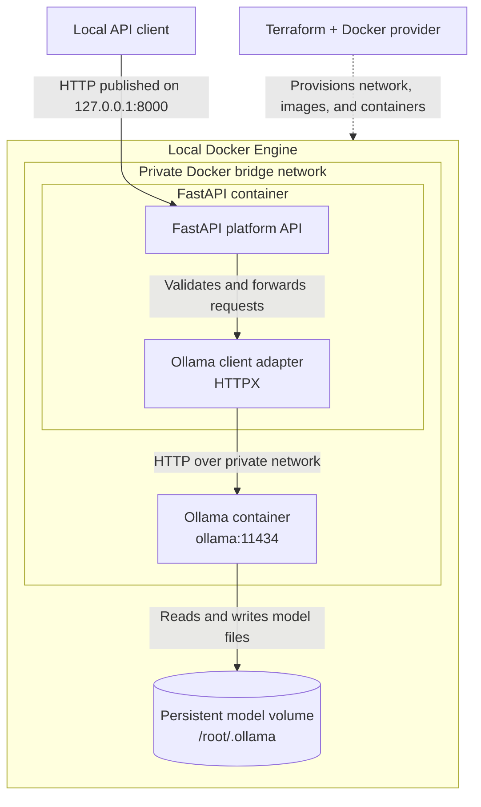

# Architecture

## Intent

Build a small, local-first AI platform that can be provisioned and operated
repeatably. The design should favor understandable components, explicit
configuration, and safe defaults over production-scale complexity.

## Selected MVP

- **Infrastructure:** Terraform with the Docker provider, in `infra/terraform/`.
- **Container runtime:** Docker Engine.
- **Platform API:** Python/FastAPI in `platform/`.
- **Model runtime:** Ollama, reachable by the API over an internal Docker
  network.
- **Host access:** publish the API on `127.0.0.1` only by default; do not publish
  Ollama's API to the host.
- **Automation and docs:** repeatable workflows belong in `scripts/`; project
  documentation belongs in `docs/` and the relevant directory README.

The MVP does not include a UI, authentication, cloud deployment, or
orchestration beyond Docker.

## Infrastructure and Software Design

The diagram shows the local Docker boundary, the chat request path, and the
resources provisioned by Terraform. The model volume persists when Terraform
destroys the containers.

## Implementation Decisions

Terraform 1.17.0 and Docker provider 4.6.0 manage the local services. The API
image uses Python 3.14.8 and defaults to the `llama3.1:8b` model; Ollama uses
the pinned `ollama/ollama:0.35.1` image.
The API port is published on loopback only, and Ollama remains on the internal
Docker bridge network. Ollama mounts a named Docker volume whose lifecycle is
outside Terraform resource management, so service teardown preserves model
data; permanent deletion is a separate operator action documented in
`infra/terraform/README.md`.

Remaining validation includes recording measured resource use for the target
hardware profile and running end-to-end tests against the pinned model without
sending prompts or model data externally.

## Operational principles

- Pin tool, provider, image, and model versions before implementation is treated
  as reproducible.
- Keep generated state and credentials out of version control.
- Make setup, health checks, upgrades, and teardown explicit and repeatable.
- Document hardware assumptions, resource requirements, and known limitations.
