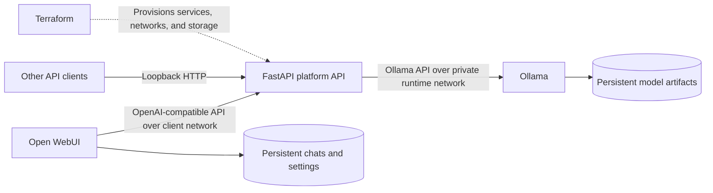

# Local AI Platform Foundation — Project Scope

## 1. Overview

The Local AI Platform Foundation is a portfolio project demonstrating the provisioning and operation of a small, local AI platform using open-source technologies.

This document defines the full release. It uses Terraform to provision local Docker resources, Open WebUI as a chat client, and a Python/FastAPI service that provides the client-facing API to locally hosted language models through Ollama.

The project prioritizes a clean, reproducible platform foundation over feature breadth. Capabilities such as retrieval-augmented generation (RAG), authentication, vector storage, advanced observability, and Kubernetes deployment are reserved for future phases.

The project demonstrates practical skills in infrastructure as code, container platforms, API design, AI runtime integration, automated testing, and architectural documentation.

## 2. Objectives

The full release will:

- Provision a local AI runtime and supporting infrastructure using Terraform.
- Run platform components in Docker containers.
- Host locally executable, open-source language models through Ollama.
- Expose a versioned platform API using Python and FastAPI.
- Provide Open WebUI as a local chat client that uses the platform API.
- Keep the platform API independently available to other clients.
- Provide interactive Swagger UI for API documentation and request execution.
- Maintain a clear boundary between the platform API and the model runtime.
- Provide repeatable setup, operation, and teardown workflows.
- Persist downloaded model artifacts independently of container lifecycle.
- Include unit tests for API behavior and repeatable Docker deployment checks.
- Document architecture, implementation decisions, configuration, and operation.
- Establish an extensible foundation for future AI platform capabilities.

## 3. Scope Boundaries

### 3.1 In Scope

The release includes:

- Terraform-managed Docker infrastructure.
- Separate Docker networks for client-to-API and API-to-runtime communication.
- Containerized FastAPI, Ollama, and pinned Open WebUI services.
- Persistent storage for Ollama model artifacts.
- Persistent Open WebUI chat history and settings, separate from the stateless API.
- Health, model-listing, and non-streaming platform chat endpoints.
- OpenAI-compatible model-listing and streaming or non-streaming chat endpoints.
- Open WebUI connected to the OpenAI-compatible API, with direct Ollama access disabled.
- Swagger UI at `/docs`, generated OpenAPI at `/openapi.json`, and ReDoc at `/redoc`.
- Request validation and normalized API responses.
- Runtime error handling and configurable request timeouts.
- Basic request logging and correlation identifiers.
- Environment-based application configuration.
- Automated unit testing and documented Docker deployment checks.
- Local setup, model preparation, operation, and cleanup documentation.

### 3.2 Out of Scope

The release excludes:

- Cloud deployment.
- Kubernetes.
- A custom product web frontend; Open WebUI is the selected chat client.
- User authentication and multi-user access control.
- Retrieval-augmented generation.
- Vector databases.
- Document ingestion.
- Agent workflows.
- Model training or fine-tuning.
- Conversation history in FastAPI. Open WebUI stores its own conversations and
  settings in a persistent Docker volume.
- Production-grade high availability.
- Healthcare data or protected health information (PHI).

### 3.3 Data and Compliance Boundary

The release must use synthetic or non-sensitive data only. Sensitive, proprietary, regulated, or personally identifiable information must not be included in source code, test fixtures, example requests, or project documentation.

Security-conscious architecture does not establish regulatory compliance. The release must not be represented as HIPAA-compliant or suitable for regulated workloads.

## 4. Technology Stack

| Area | Technologies | Purpose |
|---|---|---|
| Infrastructure | Terraform 1.17.0, Docker provider 4.6.0 | Define and provision local infrastructure |
| Container runtime | Docker Engine | Run platform services |
| Networking and storage | Docker networks and volumes | Provide internal connectivity and persistent model storage |
| Platform API | Python 3.14, FastAPI, Pydantic, Uvicorn | Expose and validate the platform API |
| Chat client | `openwebui/open-webui:0.13.4` | Provide a local interface through the platform API |
| Runtime integration | HTTPX | Communicate with Ollama over HTTP |
| Model runtime | Ollama `ollama/ollama:0.40.16` | Manage model artifacts and execute local inference |
| Testing | Pytest, HTTPX test client | Validate API behavior and verify connectivity through Docker deployment checks |
| Code quality | Ruff | Lint and format Python code |
| Optional type checking | MyPy or Pyright | Provide additional static validation |

Runtime and development dependency versions are pinned in the root
`pyproject.toml`; the API supports Python 3.14 only.

Ollama is the model runtime, deployed as a Docker container and accessed
over the private Docker network. Runtime-specific HTTP behavior remains isolated
so alternative runtimes can be evaluated later.

### 4.1 Reference Model and Validation Profile

Use Ollama's explicit `llama3.1:8b` tag as the default release model for setup and
Docker deployment verification. Refer to the [Ollama model listing](https://ollama.com/library/llama3.1)
for current model details. Do not use a floating `latest` tag. Record the
resolved model digest during deployment validation, and keep the model
configurable through Docker deployment settings.

The CPU-only validation target is an x86-64 host with 8 GiB of RAM and
at least 10 GiB of free disk space. This is a target profile, not a verified
minimum requirement. Validate it during implementation and record the tested
host OS, CPU, memory, free disk, and measured peak resource use before claiming
it as supported.

## 5. High-Level Architecture



Terraform provisions the client and runtime Docker networks, containers, loopback port mappings, persistent storage, and infrastructure-level configuration.

### 5.1 Request Flow

1. Open WebUI or another client submits a request to FastAPI. Open WebUI uses
   the OpenAI-compatible `/v1` endpoints; other clients can also use the
   versioned `/api/v1` platform endpoints.
2. FastAPI validates the request against the selected API schema.
3. The runtime adapter translates the request into the Ollama contract.
4. Ollama executes inference using an available local model.
5. The adapter translates the runtime response into the platform response
   schema or streams generated text to FastAPI.
6. FastAPI returns the response and records basic request metadata.

Clients interact with the platform API rather than depending directly on Ollama-specific interfaces.

## 6. Component Responsibilities

### 6.1 Terraform

Terraform is responsible for:

- Creating separate client and runtime Docker networks.
- Provisioning Open WebUI, Ollama, and FastAPI containers.
- Assigning the Ollama container the stable name `ollama` for model preparation.
- Provisioning named volumes for model artifacts and Open WebUI data.
- Configuring service connectivity and required port mappings.
- Defining container restart behavior.
- Applying infrastructure configuration through documented variables.

Terraform must not contain application logic or prompt-processing logic.

The storage lifecycle must distinguish routine service teardown from explicit deletion of model artifacts.
Routine teardown also preserves Open WebUI conversations and settings.

### 6.2 FastAPI Platform API

The platform API is responsible for:

- Exposing the external API contract.
- Providing OpenAI-compatible model listing and streaming or non-streaming chat
  completion routes for Open WebUI and other clients.
- Validating incoming requests.
- Routing inference requests through a runtime client or adapter.
- Returning normalized responses.
- Handling runtime connectivity failures and timeouts.
- Providing health information.
- Recording basic request logs and correlation identifiers.

Ollama-specific payloads and transport details must remain within the runtime integration layer. Open WebUI must call FastAPI over the client network, and its direct Ollama integration is disabled.

### 6.3 Open WebUI

Open WebUI is responsible for:

- Providing the local browser-based chat interface, published on
  `127.0.0.1:3000` by default.
- Sending model-listing and chat requests to the FastAPI service through the
  OpenAI-compatible API on the client Docker network.
- Keeping direct Ollama access disabled so model requests pass through FastAPI.
- Persisting conversations and settings in its named Docker volume mounted at
  `/app/backend/data`.

Open WebUI is a client of the platform API. It does not own model execution or
connect directly to the Ollama runtime.

### 6.4 Ollama

Ollama is responsible for:

- Managing local model artifacts.
- Loading and running local models.
- Processing generation requests.
- Providing the internal runtime HTTP API.

Ollama remains an implementation detail behind the platform API.

## 7. API Scope

### 7.1 API Landing Page

```http
GET /
```

**Purpose:** Return a simple HTML landing page showing the current API version.
The displayed version comes from FastAPI's application version metadata.

### 7.2 Health

```http
GET /health
```

**Purpose:** Confirm that the FastAPI application is running.

This is a liveness check and does not call Ollama. A successful response is:

```json
{"status":"ok"}
```

### 7.3 List Models

```http
GET /api/v1/models
```

**Purpose:** Return models available in the local runtime.

The response contains model names only, avoiding runtime-specific metadata:

```json
{"models":[{"name":"llama3.1:8b"}]}
```

### 7.4 Chat Completion

```http
POST /api/v1/chat
```

**Purpose:** Submit a conversational request to a selected local model and return a generated response.

Conceptual request:

```json
{
  "model": "llama3.1:8b",
  "messages": [
    {
      "role": "user",
      "content": "Explain infrastructure as code."
    }
  ],
  "options": {
    "temperature": 0
  }
}
```

The platform's native chat route supports non-streaming responses. The
implemented request and response schemas are published through FastAPI's
generated OpenAPI specification.

The implemented request contract accepts 1–100 messages with roles `system`,
`user`, or `assistant`; message content must be non-blank and no longer than
32,000 characters. `model` is optional and defaults to `DEFAULT_MODEL`. The
only supported option is `temperature`, between 0 and 2.

Successful responses use the normalized form:

```json
{
  "model": "llama3.1:8b",
  "message": {"role":"assistant","content":"..."}
}
```

Errors use an `error` object containing a stable `code` and safe `message`, plus
a `request_id`. Validation responses may include field-level details. The API
maps invalid requests to 422, unavailable models to 404, runtime timeouts to
504, runtime connectivity failures to 503, invalid upstream responses to 502,
and unexpected failures to 500. Every response includes an `X-Request-ID`
header. Request logs include method, path, status, duration, and request ID, but
never request or response content.

Expected error scenarios include:

- Invalid request data.
- An unavailable or unknown model.
- An unreachable model runtime.
- An inference request exceeding the configured timeout.
- An unexpected runtime failure.

### 7.5 OpenAI-Compatible API

Open WebUI and other API clients use these routes:

```http
GET /v1/models
POST /v1/chat/completions
```

`GET /v1/models` returns the available runtime model names in OpenAI model-list
format. Chat completions accept `system`, `user`, and `assistant` messages and
the selected model. `temperature` is optional. Setting `stream` to `true`
returns OpenAI-compatible server-sent events; the default is a JSON completion
response. Errors use the OpenAI error shape and include `X-Request-ID`.

The platform API remains independently available to direct callers. It does
not store chat history; each request supplies the messages for that turn.

### 7.6 Interactive API Documentation

Swagger UI must be available at `/docs`, backed by the generated OpenAPI
specification at `/openapi.json`. ReDoc is available at `/redoc`. Users can
inspect the API operations and submit requests through Swagger UI's **Try it
out** controls. Include a `POST /api/v1/chat` example using the default model,
one user message, and temperature `0`. Open WebUI is the selected chat client;
custom frontend development is out of scope.

## 8. Configuration

Application configuration will be supplied through environment variables and documented in `.env.example`.

| Variable | Purpose |
|---|---|
| `OLLAMA_BASE_URL` | Internal HTTP address of the Ollama service |
| `DEFAULT_MODEL` | Default model identifier; `llama3.1:8b` for this release |
| `API_HOST` | Application bind address; local process defaults to `127.0.0.1`, while the container sets `0.0.0.0` and relies on loopback-only host port publishing |
| `API_PORT` | Application listening port |
| `LOG_LEVEL` | Application logging verbosity |
| `REQUEST_TIMEOUT_SECONDS` | Timeout for runtime requests |

The application reads process environment variables directly. `.env.example`
is documentation only and is not loaded automatically.

Infrastructure configuration will use Terraform variables, with example values documented in `infra/terraform/terraform.tfvars.example`.

Configuration loading and precedence must be documented; `.env.example` is a reference template, not an automatically loaded configuration mechanism.

The release requires no secrets. Any secrets introduced during future development must not be committed to the repository.

## 9. Persistence and Data Lifecycle

The release requires persistent storage for Ollama model artifacts and Open WebUI
conversation history and settings. FastAPI does not persist conversations.

Model data must survive:

- Container restarts.
- Routine Terraform re-application.
- FastAPI image rebuilds and container replacement.
- Routine platform service teardown.

Model artifacts must be deleted only through a documented, explicit cleanup process.

The Ollama container mounts a named Docker volume that is not managed as a
Terraform resource. Routine `terraform destroy` removes the container while
Docker preserves the named volume on the host; a later apply reuses it. Permanent
deletion is a separate, explicit `docker volume rm` operation documented in
`infra/terraform/README.md`.

Open WebUI mounts a separate named Docker volume at `/app/backend/data`; routine
Terraform teardown preserves it. Permanent removal of chat history and settings
is a separate explicit cleanup operation. User records and application state
in FastAPI remain outside this release's scope.

## 10. Security and Operational Constraints

The platform is intended for local Docker deployment and portfolio
demonstration, not as a publicly accessible service.

The release must:

- Bind published FastAPI and Open WebUI ports explicitly to `127.0.0.1`; do
  not publish Ollama's API to the host.
- Put Open WebUI and Ollama on separate Docker networks, with FastAPI attached
  to both, so the UI reaches Ollama through the API.
- Disable Open WebUI's direct Ollama integration.
- Avoid logging prompt and response content by default.
- Use synthetic or non-sensitive inputs.
- Exclude local configuration, Terraform state, and generated artifacts from version control as appropriate.
- Document resource requirements and expected limitations.

Authentication is out of scope and disabled for this single-user local setup.
The placeholder bearer token Open WebUI sends is ignored by FastAPI; it is not
authentication. The unauthenticated services must remain bound to loopback.

Inference latency and supported model size depend on available CPU, memory, storage, and optional GPU capability. No production throughput or availability commitment is included in this scope.

## 11. Operational Workflow

### 11.1 Prerequisites

The setup documentation must identify:

- Supported local environment.
- Docker Engine, Terraform 1.17.0, Docker provider 4.6.0, and Python 3.14.
- Application image build steps.
- The reference validation profile: CPU-only x86-64, 8 GiB RAM, and at least
  10 GiB free disk; record actual test results before treating it as verified.
- Network access required to download dependencies, images, and model artifacts.

### 11.2 Provision Infrastructure

From the repository root:

```bash
terraform -chdir=infra/terraform init
terraform -chdir=infra/terraform validate
terraform -chdir=infra/terraform plan
terraform -chdir=infra/terraform apply
```

### 11.3 Prepare a Model

After the Ollama container starts, download the canonical test model:

```bash
docker exec ollama ollama pull llama3.1:8b
```

The Ollama container must have the stable name `ollama` for this command. Model
download orchestration does not need to be implemented as Terraform application
logic. Record the resolved model digest during setup; local overrides may use
another installed model.

Record the resolved digest shown by `docker exec ollama ollama list` when
capturing setup results.

### 11.4 Verify the Platform

```bash
curl http://localhost:8000/health
curl http://localhost:8000/api/v1/models
```

Then submit a chat request to `POST /api/v1/chat` using an installed model.

### 11.5 Teardown and Cleanup

The Ollama container uses a named Docker volume outside Terraform resource
management, so routine `terraform destroy` removes the service resources while
preserving model artifacts on the Docker host.

Where services are managed in the primary Terraform configuration, the teardown command is:

```bash
terraform -chdir=infra/terraform destroy
```

A separate, explicit cleanup procedure is documented in
`infra/terraform/README.md`; do not remove retained model artifacts as part of
routine teardown.

## 12. Testing and Quality

### 12.1 Unit Tests

Unit tests should cover:

- Request validation.
- Platform-to-runtime request translation.
- Runtime-to-platform response normalization.
- Configuration handling.
- Error and timeout mapping.

### 12.2 Docker Deployment Checks

After deployment, verify the environment through the API published on
`127.0.0.1:8000`:

- The API health endpoint responds successfully.
- The model-listing endpoint reaches Ollama on the private Docker network.
- The chat endpoint returns a response using the installed reference model.

Also verify Open WebUI can list models and complete a streamed chat through the
published API. These are deployment smoke checks, not a host-local Ollama
integration-test suite. Do not assert exact generated text.

### 12.3 Quality Checks

The project must provide documented commands for:

- Running unit tests.
- Linting and formatting with Ruff.
- Validating Terraform configuration.
- Verifying the deployed API and runtime through the published API.

Static type checking with MyPy or Pyright is optional for this release.

## 13. Key Risks and Dependencies

| Risk or dependency | Impact | Mitigation |
|---|---|---|
| Insufficient local compute or memory | Slow inference or model load failures | Validate with a small model and document tested hardware |
| Large model downloads | Longer setup times and increased disk usage | Document download sizes and persist model artifacts |
| Runtime API changes | Model-listing or chat failures | Isolate the runtime adapter and verify the pinned runtime in Docker |
| Destructive storage lifecycle | Loss of downloaded models | Separate retention from routine teardown and verify cleanup behavior |
| Nondeterministic model output | Unreliable deployment checks | Verify successful responses without requiring exact generated wording |
| Terraform and Compose ownership overlap | Conflicting infrastructure state | Keep Terraform primary and clearly separate optional Compose workflows |

## 14. Future Enhancements

Potential future phases include:

- Expanded model management and configuration.
- Request and response metrics.
- OpenTelemetry tracing.
- Structured audit logging.
- PostgreSQL metadata storage.
- Document ingestion.
- Vector search with Qdrant.
- RAG workflows.
- Authentication with Keycloak.
- Kubernetes deployment.
- Azure and AWS infrastructure.
- CI/CD automation and Terraform security scanning.

These capabilities are outside the current release scope. Any future scope change should be evaluated for requirements, operational cost, security implications, and architectural impact.

## 15. Project Positioning

This project demonstrates:

- Infrastructure as code with Terraform.
- Local container platform provisioning.
- Python API development and FastAPI service design.
- Local language model execution.
- API integration with an AI runtime.
- Persistent model storage.
- Automated testing.
- Reproducible operational workflows.
- Architecture and decision documentation.
- A foundation for future AI platform capabilities.

### Portfolio Summary

> I built a reproducible local AI platform foundation using Terraform, Docker, Open WebUI, Python, FastAPI, and Ollama, with a clean API boundary between clients and locally hosted language models.
