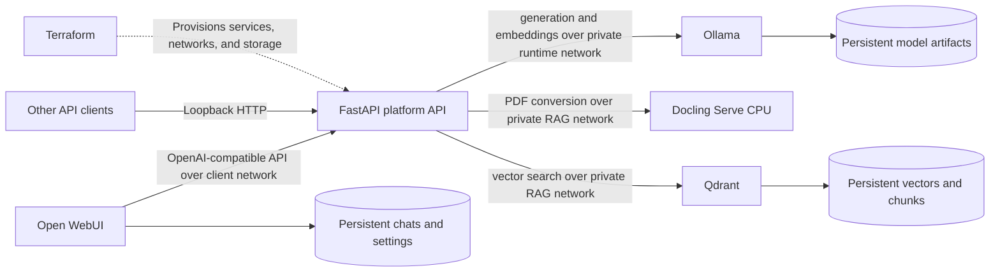

# Local AI Platform Foundation — Project Scope

## 1. Overview

The Local AI Platform Foundation is a portfolio project demonstrating the provisioning and operation of a small, local AI platform using open-source technologies.

This document defines the full release. It uses Terraform to provision local Docker resources, Open WebUI as a chat client, and a Python/FastAPI service that provides the client-facing API to locally hosted language models through Ollama. The release also includes local PDF retrieval-augmented generation (RAG), with Docling Serve for document conversion and Qdrant for vector search.

The project prioritizes a clean, reproducible local platform. Cloud deployment, authentication, advanced observability, and Kubernetes remain outside this release.

The project demonstrates practical skills in infrastructure as code, container platforms, API design, AI runtime integration, automated testing, and architectural documentation.

The RAG architecture and alternatives are recorded in
[`docs/decisions/0001-local-rag-architecture.md`](decisions/0001-local-rag-architecture.md).

## 2. Objectives

The full release will:

- Provision a local AI runtime and supporting infrastructure using Terraform.
- Run platform components in Docker containers.
- Host locally executable, open-source language models through Ollama.
- Ingest PDF documents locally and answer questions using retrieved document passages.
- Let users choose direct chat or RAG for each supported Ollama chat model.
- Keep document conversion, embedding, vector search, and generation behind the platform API.
- Expose a versioned platform API using Python and FastAPI.
- Provide Open WebUI as a local chat client that uses the platform API.
- Keep the platform API independently available to other clients.
- Provide interactive Swagger UI for API documentation and request execution.
- Maintain a clear boundary between the platform API and the model runtime.
- Provide repeatable setup, operation, and teardown workflows.
- Persist downloaded model artifacts independently of container lifecycle.
- Include unit tests for API behavior and repeatable Docker deployment checks.
- Document architecture, implementation decisions, configuration, and operation.
- Establish an extensible foundation for future AI platform capabilities.

## 3. Scope Boundaries

### 3.1 In Scope

The release includes:

- Terraform-managed Docker infrastructure.
- Separate Docker networks for client-to-API, API-to-runtime, and API-to-RAG-service communication.
- Containerized FastAPI, Ollama, official Docling Serve CPU, Qdrant, and pinned Open WebUI services.
- Persistent storage for Ollama model artifacts.
- Persistent storage for indexed document chunks, vectors, and source metadata in Qdrant.
- Persistent Open WebUI chat history and settings, separate from the stateless API.
- PDF ingestion through the official Docling Serve API, running in its own container.
- Synchronous PDF upload and indexing, with a hard file-size ceiling of 1 GB
  (1,000,000,000 bytes) and one active upload at a time.
- A configurable 120-second end-to-end ingestion deadline, with temporary-file
  and partial-index cleanup on success, failure, timeout, and cancellation.
- Ollama-backed embeddings using the fixed `nomic-embed-text:v1.5` model.
- A RAG variant for supported chat models in the OpenAI-compatible model list; each RAG variant uses the same underlying Ollama generation model as its direct-chat variant.
- Document listing, deletion, search, and RAG chat operations through FastAPI.
- Source references in RAG answers, including PDF page information when returned by extraction.
- Health, model-listing, and non-streaming platform chat endpoints.
- OpenAI-compatible model-listing and streaming or non-streaming chat endpoints.
- Open WebUI connected to the OpenAI-compatible API, with direct Ollama access disabled.
- Swagger UI at `/docs`, generated OpenAPI at `/openapi.json`, and ReDoc at `/redoc`.
- Request validation and normalized API responses.
- Runtime error handling and configurable request timeouts.
- Basic request logging and correlation identifiers.
- Environment-based application configuration.
- Automated unit testing and documented Docker deployment checks.
- Local setup, model preparation, operation, and cleanup documentation.

### 3.2 Out of Scope

The release excludes:

- Cloud deployment.
- Kubernetes.
- A custom product web frontend; Open WebUI is the selected chat client.
- User authentication and multi-user access control.
- Cloud document storage or third-party hosted parsing, embedding, or vector services.
- Formats other than PDF in the initial ingestion release.
- OCR for scanned PDFs until resource use and page-citation quality have been validated on the target host.
- Agent workflows.
- Model training or fine-tuning.
- Conversation history in FastAPI. Open WebUI stores its own conversations and
  settings in a persistent Docker volume.
- Production-grade high availability.
- Healthcare data or protected health information (PHI).

### 3.3 Data and Compliance Boundary

The release must use synthetic or non-sensitive data only. Sensitive, proprietary, regulated, or personally identifiable information must not be included in source code, test fixtures, example requests, or project documentation.

Security-conscious architecture does not establish regulatory compliance. The release must not be represented as HIPAA-compliant or suitable for regulated workloads.

## 4. Technology Stack

| Area | Technologies | Purpose |
|---|---|---|
| Infrastructure | Terraform 1.17.0, Docker provider 4.6.0 | Define and provision local infrastructure |
| Container runtime | Docker Engine | Run platform services |
| Networking and storage | Docker networks and volumes | Provide internal connectivity and persistent model storage |
| Platform API | Python 3.14, FastAPI, Pydantic, Uvicorn | Expose and validate the platform API |
| Chat client | `openwebui/open-webui:0.13.4` | Provide a local interface through the platform API |
| Runtime integration | HTTPX | Communicate with Ollama over HTTP |
| Model runtime | Ollama `ollama/ollama:0.40.16` | Manage model artifacts and execute local inference |
| PDF conversion | `ghcr.io/docling-project/docling-serve-cpu:v1.38.2` | Convert uploaded PDFs to structured text and metadata; record image digest before deployment |
| Embeddings | Ollama `nomic-embed-text:v1.5` | Embed document chunks and user queries as 768-dimensional vectors |
| Vector search | `qdrant/qdrant:v1.20.2` | Use Cosine distance; persist vectors, chunk text, and source metadata; record image digest before deployment |
| Testing | Pytest, HTTPX test client | Validate API behavior and verify connectivity through Docker deployment checks |
| Code quality | Ruff | Lint and format Python code |
| Optional type checking | MyPy or Pyright | Provide additional static validation |

Runtime and development dependency versions are pinned in the root
`pyproject.toml`; the API supports Python 3.14 only.

Ollama is the model runtime, deployed as a Docker container and accessed
over the private Docker network. Runtime-specific HTTP behavior remains isolated
so alternative runtimes can be evaluated later.

### 4.1 Reference Model and Validation Profile

Use Ollama's explicit `llama3.1:8b` tag as the default release model for setup and
Docker deployment verification. Refer to the [Ollama model listing](https://ollama.com/library/llama3.1)
for current model details. Do not use a floating `latest` tag. Record the
resolved model digest during deployment validation, and keep the model
configurable through Docker deployment settings.

The primary validation host is Windows with Docker Desktop configured for WSL2
and Linux containers; other host operating systems remain unverified. The
target profile is a modern 8-core x86-64 CPU with AVX2 preferred, 32 GiB of host
RAM with about 24 GiB available to Docker, and SSD storage. Keep at least 50 GB
free in Docker's data location before downloading images and models, then
use 10 GB free after setup as a provisional planning target. It is not a
verified minimum or an ongoing free-space floor. Benchmark peak temporary
processing use and Qdrant growth before setting the ongoing reserve. Validate
CPU-only first; an NVIDIA GPU is optional for Ollama and requires separate
validation.
Docling Serve uses its CPU image. Record the tested host OS, CPU, memory, free
disk, peak resource use, and workload results before claiming the profile as
supported. Record immutable digests for Docling Serve `v1.38.2` and Qdrant
`v1.20.2` before release; do not use floating image tags.

## 5. High-Level Architecture



Terraform provisions the client, runtime, and RAG Docker networks, containers,
loopback port mappings, persistent storage, and infrastructure-level
configuration. Only FastAPI can reach Docling Serve and Qdrant. Neither service
has a host port.

### 5.1 Request Flow

1. Open WebUI or another client submits a request to FastAPI. Open WebUI uses
   the OpenAI-compatible `/v1` endpoints; other clients can also use the
   versioned `/api/v1` platform endpoints.
2. FastAPI validates the request and resolves the selected direct or RAG model
   entry to its underlying Ollama generation model.
3. For direct chat, FastAPI sends the messages to Ollama without retrieval.
4. For RAG chat, FastAPI embeds the latest user question with
   `nomic-embed-text:v1.5`, retrieves relevant chunks from Qdrant, and adds
   source-labelled passages to the model context.
5. FastAPI sends the request to the selected Ollama generation model and
   returns or streams the answer with source references.
6. If retrieval returns no relevant passages, the RAG entry reports that the
   document set does not provide enough information. If Docling, embeddings,
   or Qdrant are unavailable, RAG requests fail visibly rather than silently
   falling back to direct chat.

Document ingestion follows a separate synchronous path: FastAPI accepts a PDF
up to 1 GB (1,000,000,000 bytes), streams it to temporary storage, sends it to
Docling Serve's file-conversion endpoint, preserves page and source metadata,
chunks the extracted content, embeds each chunk through Ollama, and stores the
chunk text, vector, and metadata in Qdrant. The full operation, including file
transfer, has a configurable 120-second deadline. Only one upload runs at a
time; another concurrent request receives HTTP 429 immediately and is not
queued. On success, failure, timeout, or cancellation, temporary files are
removed and partial Qdrant points are cleaned up. The 1 GB ceiling does not
guarantee completion within 120 seconds; establish and validate the page-count
limit on the target host. URL-based conversion is not used.

FastAPI uses one unique temporary directory per upload in the API container's
writable filesystem, not a persistent volume. Normal cleanup removes it, and
the API startup sweep removes abandoned upload directories before enabling RAG
ingestion. Qdrant points are marked `pending` while a document is indexed;
search and listing expose only `ready` documents. At startup, document IDs with
any pending points are identified, and all points for those documents are
deleted before RAG operations become available. This also removes a document
if a crash interrupts publishing its ready state. The initial cleanup design
assumes one API container and worker.

Clients interact with the platform API rather than depending directly on Ollama-specific interfaces.

## 6. Component Responsibilities

### 6.1 Terraform

Terraform is responsible for:

- Creating separate client, runtime, and RAG Docker networks.
- Provisioning Open WebUI, Ollama, FastAPI, Docling Serve CPU, and Qdrant containers.
- Assigning the Ollama container the stable name `ollama` for model preparation.
- Provisioning or reusing named volumes for model artifacts, Open WebUI data,
  and Qdrant data.
- Configuring service connectivity and required port mappings.
- Defining container restart behavior.
- Applying infrastructure configuration through documented variables.

Terraform must not contain application logic or prompt-processing logic.

The storage lifecycle must distinguish routine service teardown from explicit deletion of model artifacts.
Routine teardown also preserves Open WebUI conversations and settings.

### 6.2 FastAPI Platform API

The platform API is responsible for:

- Exposing the external API contract.
- Providing OpenAI-compatible model listing and streaming or non-streaming chat
  completion routes for Open WebUI and other clients.
- Listing direct and RAG variants for supported Ollama chat models; resolving
  RAG aliases explicitly instead of forwarding them to Ollama.
- Orchestrating PDF conversion, chunking, embeddings, vector search, and
  document lifecycle operations.
- Validating incoming requests.
- Routing inference requests through a runtime client or adapter.
- Returning normalized responses.
- Handling runtime connectivity failures and timeouts.
- Providing health information.
- Recording basic request logs and correlation identifiers.

Ollama-specific payloads and transport details must remain within the runtime
integration layer. Docling Serve and Qdrant transport details must remain in
their own adapters. Open WebUI must call FastAPI over the client network, and
its direct Ollama integration is disabled.

### 6.3 Open WebUI

Open WebUI is responsible for:

- Providing the local browser-based chat interface, published on
  `127.0.0.1:3000` by default.
- Sending model-listing and chat requests to the FastAPI service through the
  OpenAI-compatible API on the client Docker network.
- Showing direct and RAG entries for supported chat models. The RAG entry is an
  API alias, not a separate Ollama model file.
- Keeping direct Ollama access disabled so model requests pass through FastAPI.
- Persisting conversations and settings in its named Docker volume mounted at
  `/app/backend/data`.

Open WebUI is a client of the platform API. It does not own model execution or
connect directly to the Ollama runtime.

### 6.4 Ollama

Ollama is responsible for:

- Managing local model artifacts.
- Loading and running local models.
- Processing generation requests.
- Creating embeddings through the Ollama embedding API using the fixed
  `nomic-embed-text:v1.5` model. This model is not presented as a chat choice.
- Providing the internal runtime HTTP API.
- Using optional NVIDIA GPU devices when configured; CPU-only operation remains the default.

Ollama remains an implementation detail behind the platform API.

### 6.5 Docling Serve

The official Docling Serve CPU container converts uploaded PDFs to structured
text and metadata. It runs on the private RAG network, has no host port, and
accepts file uploads from FastAPI only. It does not call Ollama or Qdrant. The
initial supported input is PDF; scanned-PDF OCR remains out of scope until it
meets the target host's resource and citation checks.

### 6.6 Qdrant

Qdrant stores embedded text chunks and source metadata in persistent local
storage in `local-ai-platform-qdrant-data`. It is reachable only by FastAPI on
the private RAG network and has no host port. FastAPI owns collection setup,
upsert, search, and document deletion. The collection uses 768-dimensional
vectors with Cosine distance. FastAPI validates the embedding output size and
collection schema before enabling RAG; changing the embedding model, vector
dimension, distance metric, or input-prefix convention requires rebuilding the
collection from the source PDFs.

## 7. API Scope

### 7.1 API Landing Page

```http
GET /
```

**Purpose:** Return a simple HTML landing page showing the current API version.
The displayed version comes from FastAPI's application version metadata.

### 7.2 Health

```http
GET /health
```

**Purpose:** Confirm that the FastAPI application is running.

This is a liveness check and does not call Ollama. A successful response is:

```json
{"status":"ok"}
```

#### RAG readiness

```http
GET /health/rag
```

**Purpose:** Report whether RAG operations can be served. This separate
readiness check reports an overall `starting`, `ready`, or `unavailable`
status and the state of the RAG dependencies. It is `starting` while startup
recovery removes abandoned upload files and incomplete Qdrant documents. It
becomes `ready` only after recovery has completed and Qdrant, Docling Serve,
and the Ollama embedding model are available. It returns HTTP 200 when ready
and HTTP 503 while starting or unavailable. RAG routes also return HTTP 503
until readiness is established. The API continues serving liveness and direct
chat while RAG recovery runs; the liveness endpoint remains independent of RAG
dependencies, and direct chat can continue when Ollama is available even if
RAG is not ready.

### 7.3 List Models

```http
GET /api/v1/models
```

**Purpose:** Return available Ollama chat models. The embedding model is an
internal platform dependency and is not presented as a chat model.

The response contains model names only, avoiding runtime-specific metadata:

```json
{"models":[{"name":"llama3.1:8b"}]}
```

### 7.4 Chat Completion

```http
POST /api/v1/chat
```

**Purpose:** Submit a conversational request to a selected local model and return a generated response.

Conceptual request:

```json
{
  "model": "llama3.1:8b",
  "messages": [
    {
      "role": "user",
      "content": "Explain infrastructure as code."
    }
  ],
  "options": {
    "temperature": 0
  }
}
```

The platform's native chat route supports non-streaming responses. The
implemented request and response schemas are published through FastAPI's
generated OpenAPI specification.

The implemented request contract accepts 1–100 messages with roles `system`,
`user`, or `assistant`; message content must be non-blank and no longer than
32,000 characters. `model` is optional and defaults to `DEFAULT_MODEL`. The
only supported option is `temperature`, between 0 and 2.

Successful responses use the normalized form:

```json
{
  "model": "llama3.1:8b",
  "message": {"role":"assistant","content":"..."}
}
```

Errors use an `error` object containing a stable `code` and safe `message`, plus
a `request_id`. Validation responses may include field-level details. The API
maps invalid requests to 422, unavailable models to 404, runtime timeouts to
504, runtime connectivity failures to 503, invalid upstream responses to 502,
and unexpected failures to 500. Every response includes an `X-Request-ID`
header. Request logs include method, path, status, duration, and request ID, but
never request or response content.

Expected error scenarios include:

- Invalid request data.
- An unavailable or unknown model.
- An unreachable model runtime.
- An inference request exceeding the configured timeout.
- An unexpected runtime failure.

### 7.5 OpenAI-Compatible API

Open WebUI and other API clients use these routes:

```http
GET /v1/models
POST /v1/chat/completions
```

`GET /v1/models` returns each supported Ollama chat model as a direct entry and
a RAG entry. For example, `llama3.1:8b` is direct chat and
`llama3.1:8b-rag` is an API alias that uses the same Ollama generation model
after document retrieval. The RAG alias is not an Ollama model and must be
resolved by FastAPI before calling the runtime. Open WebUI uses the selected
entry to choose the behavior; it does not need a custom frontend or RAG toggle.

Chat completions accept `system`, `user`, and `assistant` messages and the
selected model. `temperature` is optional. Setting `stream` to `true` returns
OpenAI-compatible server-sent events; the default is a JSON completion
response. RAG answers include human-readable source references. Errors use the
OpenAI error shape and include `X-Request-ID`.

The platform API remains independently available to direct callers. It does
not store chat history; each request supplies the messages for that turn.

### 7.6 Knowledge Ingestion and RAG

FastAPI provides the following local document operations:

```http
POST   /api/v1/knowledge/documents
GET    /api/v1/knowledge/documents
DELETE /api/v1/knowledge/documents/{document_id}
POST   /api/v1/knowledge/search
POST   /api/v1/rag/chat
```

The upload endpoint accepts PDF files up to 1 GB (1,000,000,000 bytes) as a
`multipart/form-data` upload with a `file` field and processes each upload
synchronously. Users can manage documents through Swagger UI at `/docs` or with
`curl.exe`; Open WebUI remains the chat client and does not provide document
management controls. The configurable end-to-end deadline is 120
seconds by default. A second concurrent upload is rejected with HTTP 429 and
is not queued. FastAPI streams the upload to temporary storage and sends it to
Docling Serve; it does not accept remote URLs for conversion. Temporary files
and partially indexed points are cleaned up on success, failure, timeout, and
cancellation. On startup, abandoned temporary upload directories are removed;
document IDs with any pending Qdrant points are identified and all their
points are deleted before RAG routes become available. The API stores
extracted text chunks, vectors, and source
metadata in Qdrant. Search returns source identifiers and page metadata for
verification. Deleting a document removes all of its chunks from Qdrant. The
native RAG chat endpoint returns an answer and structured source references;
the OpenAI-compatible RAG entry returns citations in the answer text so Open
WebUI can display them. A practical page-count limit must be established by
resource and timing validation; the 1 GB ceiling alone does not guarantee a
file will finish within the deadline.

FastAPI calculates a SHA-256 digest while streaming each upload and uses it as
the stable document ID. A newly indexed document returns HTTP 201. Uploading
identical bytes again returns HTTP 200 with the existing document metadata and
does not create duplicate chunks. The first successful upload's filename
remains the canonical source name. A matching filename with different bytes
creates a separate document and does not replace the existing document.

The configurable `RAG_MAX_INDEXED_CHUNKS` limit caps the total indexed chunks
in the Qdrant collection. After extraction and chunking, but before embedding
or Qdrant writes, the API compares the current ready chunk count plus the
candidate document's chunk count with the cap. An upload that would exceed it
is rejected with a capacity-limit error and its temporary files are removed.
An exact-byte duplicate consumes no additional capacity; deleting a document
releases its chunks. Lowering the cap does not delete existing documents, but
new uploads are rejected until the indexed count falls below the cap. Set the
numeric default after measuring Qdrant storage growth on the target host. The
chunk cap is a logical index limit, not a physical disk quota; other Docker
data and temporary conversion files can still use host storage.

The RAG path uses the latest user message as the retrieval query. A request
with no relevant document matches returns a clear no-support response instead
of silently using general model knowledge. A Docling, Ollama embedding, or
Qdrant failure returns an error rather than bypassing retrieval.

RAG routes use stable error codes and safe messages. The native API returns
`{"error":{"code":"...","message":"..."},"request_id":"..."}` and an
`X-Request-ID` header; OpenAI-compatible routes translate errors to the
OpenAI error shape and retain the request ID. Upload and dependency failures
use these statuses:

| Condition | HTTP status | Error code |
|---|---:|---|
| Uploaded PDF exceeds 1 GB | 413 | `file_too_large` |
| Uploaded file is not a PDF media type | 415 | `unsupported_media_type` |
| Malformed PDF | 422 | `invalid_pdf` |
| Encrypted or password-protected PDF | 422 | `pdf_encrypted` |
| PDF has no extractable text | 422 | `no_extractable_text` |
| PDF exceeds the configured practical page limit | 422 | `page_limit_exceeded` |
| Upload would exceed `RAG_MAX_INDEXED_CHUNKS` | 409 | `indexed_chunk_limit_exceeded` |
| Another upload is in progress | 429 | `upload_in_progress` |
| End-to-end ingestion deadline expires | 504 | `ingestion_timeout` |
| RAG is starting or a required dependency is unavailable | 503 | `rag_not_ready` or `dependency_unavailable` |
| Docling returns an invalid response | 502 | `parser_upstream_error` |
| Physical storage is exhausted during indexing | 507 | `insufficient_storage` |
| Unexpected API failure | 500 | `internal_error` |

Every failure path removes temporary files and partial index points; messages
must not reveal document text or internal service details.

### 7.7 Interactive API Documentation

Swagger UI must be available at `/docs`, backed by the generated OpenAPI
specification at `/openapi.json`. ReDoc is available at `/redoc`. Users can
inspect the API operations and submit requests through Swagger UI's **Try it
out** controls, including selecting a PDF file for
`POST /api/v1/knowledge/documents`. Include a `POST /api/v1/chat` example using
the default model, one user message, and temperature `0`. The Getting Started
guide documents `curl.exe` examples for PDF upload, listing, and deletion.
Open WebUI is the selected chat client; custom frontend development is out of
scope.

## 8. Configuration

Application configuration will be supplied through environment variables and documented in `.env.example`.

| Variable | Purpose |
|---|---|
| `OLLAMA_BASE_URL` | Internal HTTP address of the Ollama service |
| `DEFAULT_MODEL` | Default model identifier; `llama3.1:8b` for this release |
| `API_HOST` | Application bind address; local process defaults to `127.0.0.1`, while the container sets `0.0.0.0` and relies on loopback-only host port publishing |
| `API_PORT` | Application listening port |
| `LOG_LEVEL` | Application logging verbosity |
| `REQUEST_TIMEOUT_SECONDS` | Timeout for runtime requests |
| `RAG_INGESTION_TIMEOUT_SECONDS` | End-to-end synchronous PDF upload and indexing deadline; defaults to 120 seconds and is configurable through Terraform |
| `EMBEDDING_MODEL` | Fixed Ollama embedding model; `nomic-embed-text:v1.5` |
| `DOCLING_BASE_URL` | Internal URL of the Docling Serve CPU container |
| `QDRANT_URL` | Internal URL of the Qdrant service |
| `QDRANT_COLLECTION` | Collection containing indexed document chunks |
| `RAG_MAX_INDEXED_CHUNKS` | Maximum total chunks in the collection; numeric default set from target-host storage measurements |
| `RAG_TOP_K` | Maximum number of retrieved chunks added to a prompt; initial default is 5 |
| `RAG_SCORE_THRESHOLD` | Minimum retrieval relevance required to use document context |

The application reads process environment variables directly. `.env.example`
is documentation only and is not loaded automatically.

Infrastructure configuration will use Terraform variables, with example values documented in `infra/terraform/terraform.tfvars.example`.

Configuration loading and precedence must be documented; `.env.example` is a reference template, not an automatically loaded configuration mechanism.

The initial chunking profile preserves Docling paragraph and heading
boundaries, keeps chunks within one PDF page, targets 600 tokens per chunk,
and overlaps adjacent chunks by 100 tokens. Retrieval uses vector search only
and starts with the top 5 results; hybrid search and reranking are out of scope
for the initial release. Use Nomic's `search_document:` prefix for indexed
chunks and `search_query:` for user questions. During development calibration,
compare this paired-prefix convention with raw text using a separate synthetic
set of about 10 answerable and 10 unanswerable questions. Set
`RAG_SCORE_THRESHOLD` from the calibration results; do not choose an arbitrary
numeric threshold. If relevant and irrelevant score ranges overlap
substantially, adjust retrieval instead of forcing a cutoff. Changing the
prefix convention, chunk size, or overlap requires rebuilding the Qdrant index.
The release requires no secrets. Any secrets introduced during future
development must not be committed to the repository.

After development, run a separate held-out RAG quality acceptance set with 30
questions across 6 to 10 synthetic PDFs: 20 answerable and 10 unanswerable. Pass
when at least 18 of 20 answerable questions receive a correct answer grounded
in retrieved evidence, every citation identifies the correct source and page,
and all 10 unanswerable questions receive the no-support response without an
invented answer. Do not use this held-out set to tune retrieval settings.

Use the default 768-dimensional output from `nomic-embed-text:v1.5` with Qdrant
Cosine distance, without dimension truncation. Keep RAG unavailable if the
embedding output or Qdrant collection does not match this schema. Use
`search_document:` for document chunks and `search_query:` for user queries.
Compare this paired-prefix convention with raw text only on the separate
development calibration set. Changing the input convention requires
re-embedding the collection and recalibrating the relevance threshold.

The 1 GB upload cap is a hard maximum. The practical page-count limit must be
set after measuring conversion, embedding, and indexing time and peak resource
use on the target host. `RAG_INGESTION_TIMEOUT_SECONDS` covers the full upload
request and is configured separately from `REQUEST_TIMEOUT_SECONDS`.

Measure Qdrant volume growth for the target chunking profile and use that result
to set `RAG_MAX_INDEXED_CHUNKS`. The limit controls logical collection size;
monitor host free space manually because it does not impose a physical disk
quota. The initial release does not enforce a physical free-space threshold.
Use the benchmark to define an ongoing manual reserve, accounting for peak
temporary conversion data and indexed growth; the provisional 10 GB post-setup
target is not that validated reserve.

## 9. Persistence and Data Lifecycle

The release requires persistent storage for Ollama model artifacts, Open WebUI
conversation history and settings, and Qdrant's indexed document chunks,
vectors, and source metadata. FastAPI does not persist conversations. Uploaded
PDFs are processed transiently and are not retained after ingestion. Users
keep source PDFs outside the platform if they may need to rebuild the index.
Temporary upload and conversion files must be removed after processing,
including failure paths. The initial release does not create Qdrant snapshots;
rebuild a lost index by uploading the source PDFs again. The Qdrant volume
persists across routine teardown but does not protect against volume loss.

Model data must survive:

- Container restarts.
- Routine Terraform re-application.
- FastAPI image rebuilds and container replacement.
- Routine platform service teardown.

Model artifacts must be deleted only through a documented, explicit cleanup
process. Indexed documents are removed through the document deletion API or by
an explicit Qdrant volume cleanup. Routine Terraform teardown preserves the
Qdrant volume. The deletion API removes indexed chunks and metadata; it does
not affect the user's external source PDF. If the index is lost or permanently
deleted, users must upload their source PDFs again to rebuild it.

The Ollama container mounts a named Docker volume that is not managed as a
Terraform resource. Routine `terraform destroy` removes the container while
Docker preserves the named volume on the host; a later apply reuses it. Permanent
deletion is a separate, explicit `docker volume rm` operation documented in
`infra/terraform/README.md`.

Open WebUI mounts a separate named Docker volume at `/app/backend/data`; routine
Terraform teardown preserves it. Permanent removal of chat history and settings
is a separate explicit cleanup operation. The official Docling Serve CPU image
contains its conversion models; its runtime cache is not a document archive.
User records and application state in FastAPI remain outside this release's
scope.

## 10. Security and Operational Constraints

The platform is intended for local Docker deployment and portfolio
demonstration, not as a publicly accessible service.

The release must:

- Bind published FastAPI and Open WebUI ports explicitly to `127.0.0.1`; do
  not publish Ollama, Docling Serve, or Qdrant ports to the host.
- Put Open WebUI, Ollama, Docling Serve, and Qdrant on separate Docker
  networks. FastAPI joins the client, runtime, and RAG networks and is the only
  component that can reach the parser and vector store.
- Disable Open WebUI's direct Ollama integration.
- Accept PDF file uploads only; do not use Docling Serve's URL conversion
  endpoint, which could otherwise fetch arbitrary network locations.
- Set explicit upload-size, page-count, processing-time, and concurrency
  limits for document conversion.
- Enforce a 1 GB PDF ceiling, a configurable 120-second synchronous ingestion
  deadline, and one active upload; reject concurrent uploads with HTTP 429
  without queuing.
- Stream uploads to bounded temporary storage rather than loading a complete
  PDF into memory, and remove temporary files and partial index points on all
  terminal paths. Sweep abandoned API scratch directories and delete all
  points for documents with pending chunks at startup before enabling RAG
  operations.
- Treat extracted document text as untrusted prompt context. Do not log
  document content, prompts, retrieved chunks, or model responses by default.
- Keep RAG, parsing, embedding, and vector storage local to Docker.
- Avoid logging prompt and response content by default.
- Use synthetic or non-sensitive inputs.
- Exclude local configuration, Terraform state, and generated artifacts from version control as appropriate.
- Document resource requirements and expected limitations.

Authentication is out of scope and disabled for this single-user local setup.
The placeholder bearer token Open WebUI sends is ignored by FastAPI; it is not
authentication. The unauthenticated services must remain bound to loopback.

Inference latency and supported model size depend on available CPU, memory, storage, and optional GPU capability. No production throughput or availability commitment is included in this scope.

## 11. Operational Workflow

### 11.1 Prerequisites

The setup documentation must identify:

- Primary validation environment: Windows with Docker Desktop configured for
  WSL2 and Linux containers. Other host operating systems remain unverified.
- Docker Engine, Terraform 1.17.0, Docker provider 4.6.0, and Python 3.14.
- The official Docling Serve CPU image `v1.38.2` and Qdrant image
  `qdrant/qdrant:v1.20.2`, both pinned to immutable digests before release.
- The `nomic-embed-text:v1.5` Ollama model and its resolved digest.
- Application image build steps.
- The target validation profile: modern 8-core x86-64 CPU, AVX2 preferred,
  32 GiB host RAM with about 24 GiB available to Docker, and SSD storage with
  50 GB free before setup and a provisional 10 GB post-setup target. Benchmark
  and record ongoing free-space needs before treating the profile as verified.
- Network access required to download dependencies, images, and model artifacts.

### 11.2 Provision Infrastructure

From the repository root:

```bash
terraform -chdir=infra/terraform init
terraform -chdir=infra/terraform validate
terraform -chdir=infra/terraform plan
terraform -chdir=infra/terraform apply
```

### 11.3 Prepare Models

After the Ollama container starts, download the canonical test model:

```bash
docker exec ollama ollama pull llama3.1:8b
docker exec ollama ollama pull nomic-embed-text:v1.5
```

The Ollama container must have the stable name `ollama` for these commands.
Model download orchestration does not need to be implemented as Terraform
application logic. Record both resolved model digests during setup; local
generation model overrides may use another installed chat model. The embedding
model remains fixed for the indexed collection.

Record the resolved digest shown by `docker exec ollama ollama list` when
capturing setup results.

### 11.4 Verify the Platform

```bash
curl http://localhost:8000/health
curl http://localhost:8000/api/v1/models
```

Then submit a chat request to `POST /api/v1/chat` using an installed model.
Upload a synthetic PDF through the knowledge API, verify relevant passages
with the search operation, and test a RAG chat using both direct and RAG model
entries in Open WebUI. Confirm citations identify the source PDF and page.

### 11.5 Teardown and Cleanup

The Ollama and Qdrant containers use named Docker volumes outside Terraform
resource management, so routine `terraform destroy` removes service resources
while preserving model artifacts and indexed document data on the Docker host.

Where services are managed in the primary Terraform configuration, the teardown command is:

```bash
terraform -chdir=infra/terraform destroy
```

A separate, explicit cleanup procedure is documented in
`infra/terraform/README.md`; do not remove retained model artifacts, indexed
documents, or Open WebUI data as part of routine teardown.

## 12. Testing and Quality

### 12.1 Unit Tests

Unit tests should cover:

- Request validation.
- Platform-to-runtime request translation.
- Runtime-to-platform response normalization.
- Configuration handling.
- Error and timeout mapping.
- PDF-only upload validation at the 1 GB boundary, including streamed size
  enforcement and rejection of unsupported or malformed files.
- The configurable 120-second end-to-end deadline, concurrent-upload rejection,
  temporary-file cleanup, rollback of partial Qdrant indexing, and startup
  recovery after an interrupted upload.
- RAG error codes and HTTP statuses for upload limits, unsupported or
  unprocessable PDFs, index-capacity rejection, timeouts, dependency failures,
  and unexpected errors.
- The collection-wide chunk cap at, below, and above its configured boundary;
  rejection before embedding/indexing, no additional capacity for duplicate
  uploads, and capacity release after document deletion.
- Document parser response mapping and page metadata preservation.
- Deterministic PDF chunking; SHA-256 duplicate behavior, idempotent retries,
  and document deletion.
- Embedding output dimension (768), task-prefix convention, Cosine collection
  schema, and vector-store upsert/search/delete behavior.
- Direct-versus-RAG model alias routing, no-match behavior, citation formatting,
  and dependency failure handling.

### 12.2 Docker Deployment Checks

After deployment, verify the environment through the API published on
`127.0.0.1:8000`:

- The API health endpoint responds successfully.
- The model-listing endpoint reaches Ollama on the private Docker network.
- The chat endpoint returns a response using the installed reference model.
- Docling Serve converts a synthetic PDF and preserves its source/page metadata.
- FastAPI embeds chunks and queries with `nomic-embed-text:v1.5` and Qdrant
  returns expected source chunks.
- On the primary CPU-only host profile, ingest a representative synthetic PDF
  at the practical page limit with `llama3.1:8b`, `nomic-embed-text:v1.5`,
  Docling Serve, and Qdrant running. Confirm ingestion completes within 120
  seconds without exhausting memory or disk, and a chat request completes
  during ingestion; record peak resource use and chat latency. Validate an
  NVIDIA GPU configuration separately if it is part of the tested setup.
- A RAG model entry uses the selected Ollama chat model and cites retrieved
  passages; a direct entry does not invoke retrieval.
- Deleting a document removes its chunks, and routine teardown/re-apply retains
  the Qdrant volume.

Also verify Open WebUI can list models and complete a streamed chat through the
published API. These are deployment smoke checks, not a host-local Ollama
integration-test suite. Do not assert exact generated text.

### 12.3 Quality Checks

The project must provide documented commands for:

- Running unit tests.
- Linting and formatting with Ruff.
- Validating Terraform configuration.
- Verifying the deployed API and runtime through the published API.
- Running the held-out RAG quality acceptance set and reporting answer,
  evidence, citation, and no-support results.

Static type checking with MyPy or Pyright is optional for this release.

## 13. Key Risks and Dependencies

| Risk or dependency | Impact | Mitigation |
|---|---|---|
| Insufficient local compute or memory | Slow inference or model load failures | Validate with a small model and document tested hardware |
| Large model downloads | Longer setup times and increased disk usage | Document download sizes and persist model artifacts |
| Docling CPU processing competes with Ollama | Slow ingestion or inference and memory pressure | Validate peak resource use on the reference host; bound file pages, size, and concurrency |
| Parser image and baked models exceed disk target | Deployment cannot fit the documented host profile | Measure image and volume sizes against the 50 GB pre-setup free-space target |
| Embedding model or vector schema changes | Existing vectors cannot be compared consistently | Keep one embedding model per collection and re-embed on version changes |
| Retrieved content contains hostile instructions | Model may follow untrusted document text | Delimit retrieved passages as untrusted context and test prompt-injection examples |
| Document deletion is incomplete | Removed sources remain retrievable | Delete by stable document ID across all Qdrant chunks and verify with search |
| Synchronous ingestion exceeds its deadline | Uploads fail or leave incomplete entries | Bound request size, permit one active upload, clean up partial state, and validate a practical page limit against the 120-second default |
| Indexed chunks exhaust Docker storage | Other local services may fail when the shared Docker data disk fills | Cap total Qdrant chunks using a benchmark-derived limit, monitor host free space manually, and benchmark temporary use and Qdrant growth to establish an ongoing reserve; the logical cap is not a physical disk quota |
| Runtime API changes | Model-listing or chat failures | Isolate the runtime adapter and verify the pinned runtime in Docker |
| Destructive storage lifecycle | Loss of downloaded models | Separate retention from routine teardown and verify cleanup behavior |
| Nondeterministic model output | Unreliable deployment checks | Verify successful responses without requiring exact generated wording |
| Terraform and Compose ownership overlap | Conflicting infrastructure state | Keep Terraform primary and clearly separate optional Compose workflows |

## 14. Future Enhancements

Potential future phases include:

- Expanded model management and configuration.
- Request and response metrics.
- OpenTelemetry tracing.
- Structured audit logging.
- PostgreSQL metadata storage.
- Multi-format document ingestion beyond PDF.
- OCR support for scanned PDFs after resource and citation validation.
- Hybrid lexical and vector search or reranking.
- Multiple knowledge collections and per-user isolation.
- Authentication with Keycloak.
- Kubernetes deployment.
- Azure and AWS infrastructure.
- CI/CD automation and Terraform security scanning.

These capabilities are outside the current release scope. Any future scope change should be evaluated for requirements, operational cost, security implications, and architectural impact.

## 15. Project Positioning

This project demonstrates:

- Infrastructure as code with Terraform.
- Local container platform provisioning.
- Python API development and FastAPI service design.
- Local language model execution.
- Local PDF retrieval and source-grounded answers.
- Document extraction with Docling Serve and vector search with Qdrant.
- API integration with an AI runtime.
- Persistent model storage.
- Automated testing.
- Reproducible operational workflows.
- Architecture and decision documentation.
- A foundation for future AI platform capabilities.

### Portfolio Summary

> I built a reproducible local AI platform foundation using Terraform, Docker, Open WebUI, Python, FastAPI, and Ollama, with a clean API boundary between clients and locally hosted language models.
